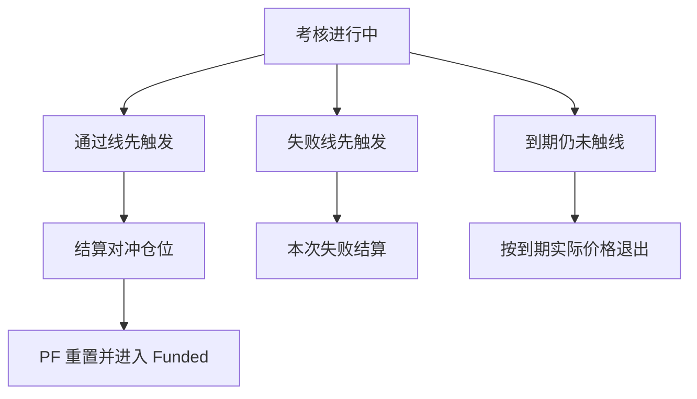

版本：1.0。整理日期：2026-11-19。交付对象：Codex。语言：中文。产品形态：本地运行的网页决策工具。

本项目的第一目标是：根据 PF 与个人实盘的当前状态，计算动态对冲比例的可行范围、候选仓位及对应现金结果。优先完成数学、账本和状态机，再接入行情、账户与可视化。合约名称不是核心算法的前置条件；具体合约规格只在换算数量、计算费用、保证金和成交压力时使用。

本文整合已有需求，并以用户后续确认的“两日结束考核、Funded 无盈利目标、10,100 分配 100 后用户到手 80 且账户回到 10,000”为准。本文给出的是待开发规格和验收要求，不表示完整应用已经实现或通过测试。

# 1 给 Codex 的执行要求

请直接根据本文开发，不要只交付方案说明或静态展示页。

1. 如已有项目，先阅读仓库指引、检查现有结构与测试，保留用户已有改动；没有项目时建立可本地启动的 TypeScript 网页项目。

2. 先实现独立纯函数计算引擎、事件账本和核心验收用例，再实现界面与只读数据适配器。数学层不得依赖 UI 或实时网络。

3. 默认使用本文确认的参数。其他缺失参数保留可编辑输入和明确的“未验证”状态，不用编造参数填补，不以选择某个币种作为继续开发的前提。

4. 对冲比例与仓位规模联合求解；提款参考位置支持用户指定的单点或有限候选点集合比较，未给目标集合时只做单目标求解，不声称已找到全局最佳提款位置。禁止把 10%、15%、20%、50%、每次固定 1,000U 或固定轮数写成策略。

5. 输出必须能解释：下限为何这么大、上限由什么约束决定、为什么无解、哪个字段缺失、成功端及失败端各剩多少钱。

6. 系统只读。允许本地模拟成交，不实现真实下单、撤单、签名、划转或提款，不索要或保存私钥。读取公开钱包地址不需要交易密钥。

7. 不部署公网，不发送外部消息。完成后提供源码、启动命令、真实测试结果和未验证项；不能把 Mock 通过写成 Live API 验证通过。

# 2 默认业务规则及来源

## 2 1 用户确认的计算情景

所有金额先以统一记账单位 U 表示；实盘接入后同时保留实际币种，USDC、USDT、USD 不得未经汇率处理直接混用。

| 参数 | 默认值 | 约束 |
| --- | --- | --- |
| 个人初始总资金 B | 500U | 已包含报名费 |
| 单次考核购买费 | 91U | 新购一次扣一次，不按行情刷新或每笔交易重复扣 |
| 初始 Hype 现金 | 409U | 500 − 91 |
| 考核 PF 起点 | 10,000U | PF 账本不属于个人实盘抵押品 |
| 考核通过线 | 12,000U | 以配置的 PF 自身净结算口径判定 |
| 考核固定失败线 | 9,400U | 初始亏损空间 600；不随高点上移 |
| 考核利润 | 不可提款 | 通过取得下一阶段账户，不直接产生个人现金 |
| 考核期限 | 两日结束本次尝试 | 见第 8 节的截止口径和到期处理 |
| 通过后 PF 起点 | 10,000U | 仅重置 PF 阶段账户，实盘与历史费用延续 |
| Funded 固定失败线 | 8,000U | 按用户给定模型；初始亏损空间 2,000 |
| Funded 强制盈利目标 | 无 | 用户设置的 E_target 是提款参考点 |
| 利润分配起点 | 10,000U | 低于此线的恢复收益不能提款 |
| 用户分成 | 80% | 平台分成 20% |
| 分配扣款 | PF 扣除全部已分配毛利润 | 10,100 分配 100 后 PF 回到 10,000；用户 80，平台 20 |
| 下一轮利润起点 | 10,000U | 本模型保持固定，不抬成 10,100 |
| VS 默认单边手续费率 | 0.0001，即 0.01% | 模拟参数，可编辑，不冒充实际账户费率 |
| Hype 默认单边手续费率 | 0.0005，即 0.05% | 模拟参数，可编辑，不冒充实际账户费率 |

Funded 默认演示参考点为 10,100；它不是平台的盈利目标。支持在每次利润实际到账后，以同一固定起点规则继续进行下一轮条件推演。

演示配置默认 `passTrigger="net_settlement"`、`failureTrigger="net_settlement"`，与本文精确数值用例保持一致；这不是对实际平台触线口径的确认。实际账户模式按已验证规则选择口径，并保留切换前后计算差异。

## 2 2 规则与事实必须分层

每个规则记录 `source`、`verifiedAt`、`profileVersion` 和验证状态。默认配置标记 `user_provided`，演示费用、市场参数标记 `simulation_assumption`，真正读取的接口数据标记 `api`。

用户给定的 Funded 8,000 失败线与当前公开标准账户说明并不相同；不得把默认情景标成已核验的 Vest 通用规则，也不得擅自改为其他失败线。两日期限是用户的操作要求。实际平台若还有日亏损、交易时段或其他限制，作为独立规则输入叠加，不将其隐含进固定最大回撤。[S1]

确认状态仅影响结论标签，不能阻止离线计算开发。未验证实际账户规则时可以展示条件结果，但不能展示“实盘全部条件已验证”。

# 3 两套账本和资金口径

## 3 1 PF 账户账本

保留 `balance`、`unrealizedPricePnl`、`fundingAccrued`、`feesPaid`、`equityMark`、`equityIfClosed`、`stage`、`positions` 和账户规则。

`equityMark` 是已发生账务调整后的余额加当前浮动盈亏；已经进入余额的手续费或资金费不能再加减一次。

`equityIfClosed` 是从当前状态按指定成交压力平仓后的预计 PF 净值，额外扣除尚未发生的 PF 平仓费用与成交损耗。两种权益口径必须分别显示，禁止混用。

PF 通过、失败和可分利润只根据 PF 自身数据判定。Hype 的费用不从 PF 净值扣除。默认通过和利润申领采用 `net_settlement`；失败判定口径独立配置，并在演示配置中明确设置。

## 3 2 个人真实资金账本

记录报名费、Hype 现金与浮盈亏、Hype 实际交易费用、资金费、真实到账分成，以及个人各资金账户之间的转移。

至少分开以下字段：

| 字段 | 含义 |
| --- | --- |
| C_hl | 实际位于 Hype、属于相应账户资金池的真实权益 |
| C_external | 已到账、位于其他个人资金账户的余额 |
| transferInTransit | 已从来源扣除但尚未到目的地的已确认转移资产；不作为Hype抵押品 |
| C_total | 去重后的个人经济权益；包含已确认归属的在途转移资产，用于本轮绩效核对 |
| C_protect | 失败结算情景下可纳入本金回收的权益；默认不包括在途资产，基础情景为C_hl + C_external |
| payoutReceivable | 已产生但未实际到账的应收分成；不加入 C_total 或 C_hl |
| B | 本次项目要保住的个人本金基准，默认 500 |
| C_ref | 本轮开始时固定记录的 C_total |
| externalContributions | 额外投入本金；不得当成策略盈利 |
| externalWithdrawals | 真实取出资金；用于累计回收统计，不重复加进外部余额 |

简化界面可先假设全部个人资金都在 Hype，此时 `C_total = C_protect = C_hl = C`。正式数据模型必须支持各口径分离：外部钱包或 Vest Primary Account 的资金不是 Hype 的抵押品。资产归属或可回收性未确认时单列为未知，不算作可用现金。

使用资金转移事件在两个位置之间移动余额，不能在原位置保留余额、又在目标位置增加同一笔资金。来源扣款时原子地移入 transferInTransit，目的地确认到账时原子地冲销在途并入账。没有转账费用或估值变化时，转移前后 C_total 不变；C_hl 和 C_protect 按实际到位情况变化。真实转账费用另记，外部追加本金、取出本金须单独归类。

历史费用已经反映在当前资金中，比较失败端可回收资金与 `B=500` 已包含该历史缺口。不得再把同一历史费用加到 B 上。在途资金单独处理，不被误标为新发生的策略亏损。新购账号会再扣购买费，但不会自动把保护基准从 500 重置为剩余金额。

## 3 3 C_ref 的冻结规则

本轮正式开始时记录 C_ref，并保存建立它的事件 ID。行情刷新、浮盈变化、调整仓位、编辑快照、重新求解 h，都不能重置 C_ref。

默认在本轮仓位结算、利润分配处理完成、计划用于下一轮的分成实际转入 Hype 后，开启下一轮并建立新 C_ref。待到账期间可以继续查看行情，但默认不自动开启新模拟轮次。若支持在待到账期间继续模拟，必须独立验证资金承受力，不能使用应收作为抵押品。

如果允许轮内外部出入金，本轮策略增益应为 `C_end − C_ref − 本轮额外投入 + 本轮对外取出`，并从个人累计回收与即时可用保证金中分别展示。

# 4 对冲比例定义与合约归一化

对冲比例 `h` 定义为 Hype 反向持仓对共同价格因子的盈亏敏感度，除以 PF 持仓对同一因子的盈亏敏感度。

```text
theta_vs = d(PF 价格盈亏) / d(共同价格因子)
theta_hl = d(Hype 价格盈亏) / d(共同价格因子)
h = abs(theta_hl) / abs(theta_vs)
当h>0时的反向条件：theta_hl × theta_vs < 0
```

共同因子可采用同一标的的标准化价格变动。简单的同标的线性匹配中，PF 价格盈亏为 x，Hype 价格盈亏为 `−h × x`。不同乘数、币种、报价单位和映射关系要先换算，不能直接拿手数或保证金相除。

线性合约的单笔价格盈亏：`有符号数量 × 合约乘数 × 价格变动 × 有效汇率`。不支持的反向、非线性或不可验证映射合约返回 `UNSUPPORTED_INSTRUMENT`。名称相似不证明可对冲。

`h` 不是杠杆倍数，也不是两边保证金的比例。允许 h 大于 1，是否可行由资金和风险约束决定。h=0是显式未对冲候选，仍验证PF自身规则。PF 仓位为零时返回 `HOLD`，比例为 `null`，不做除零运算。

# 5 第一层求解器与可解释公式

## 5 1 成立范围

此层用于解释、零成本基准和人工预算压力测试：从当前状态起，保持所选比例到下一个参考事件；两边价格盈亏线性匹配；D、T 在同一近似口径下计算。它不替代逐笔费用、真实保证金或路径验证。

```text
D = E − floor
T = E_target − E
P = 0                                  // 考核阶段
P = 0.8 × max(E_target − 10000, 0)       // Funded 阶段
```

基础模型用 C 表示个人资金全在 Hype。k 是该互斥终点情景下的未来现金摩擦预算，每个情景各扣一次，不能在同一条真实账本路径重复扣。已计入 C 的历史费用不能再计入 k。

```text
失败端真实资金       C_fail   = C + h × D − k
成功端到账前真实资金 C_before = C − h × T − k
成功端到账后真实资金 C_after  = C_before + P
本轮真实增益         gain     = C_after − C_ref

h_min        = max(0, (B − C + k) / D)
h_max_cash   = (C − R − k) / T
h_max_profit = (C + P − C_ref − g − k) / T
```

Funded 的现金可行区间为 `[h_min, min(h_max_cash, h_max_profit)]`。考核没有可提利润，不套用本轮盈利上限，只保留通过后续航现金约束。真实执行候选还要通过保证金、步长、规则、数据和路径筛选。

如果个人资金分散在不同位置，保护下限使用 C_protect，本轮增益使用 C_total，到账前 Hype 生存约束用 C_hl。在没有在途转移和其他受限资产时C_protect=C_total。不得以 C_total 替代 C_hl 计算保证金。

下列条件先返回状态，不继续求比值：

- D ≤ 0：失败底线已触及。

- 考核当前终点已达到：进入待结算或已通过状态。

- Funded 的 E_target ≤ 10,000：该参考点无可申领利润。

- E_target ≤ E：参考点已达到；转入当前可申领额检查，不继续新增目标计算。

- h_max < 0 或 h_min > h_max：无可行区间，不将负上限截成零后伪造可行。

- 缺失、NaN、无穷、无效币种或未支持合约：明确错误，不当成零。

## 5 2 比例选择目标

默认目标是：满足失败端保护要求、到账前现金和保证金约束之后，最大化成功端本轮真实增益。对固定目标、固定 k 的线性模型，优先候选是最低可行 h。成本或约束随 h 改变时，必须在合法离散仓位上重新评估。

```text
gain_max_at_endpoint = C + P − C_ref − k − T × h_min
```

允许切换排序目标，例如两个价格终点的较差现金最大、较低保证金占用或较大清算缓冲。每次展示所选目标、候选范围、约束状态，不无条件称为“最佳比例”。没有概率模型就不输出期望利润或通过概率。

## 5 3 动态更新机制

数据快照、费用、资金到账、目标或规则变化时重算。完美线性且无费用时，单纯价格变化可能让 h_min 保持不变；不为制造“动态”效果而强行调仓。

调整建议必须同时显示 `currentQuantity`、`targetQuantity` 和 `deltaQuantity`。只有差额构成拟交易量；保留中的已有仓位不再次计算开仓费。

```text
C_t = C_0 − sum(h_i × ΔX_i) − sum(本段真实现金费用_i)
      + sum(实际到账分成_i) + 外部净入金
```

这里 ΔX_i 是该段匹配的 PF 价格盈亏分量。不能用最后一个 h 乘全部历史 PF 净值变化。最终账务以逐笔成交、费用、资金费和资金转移事件为准。

# 6 第二层精确费用与终点反解

## 6 1 成交与成本原则

每次开仓、增仓、减仓、反手和平仓按实际成交名义额独立计费。平仓名义额随价格变化，不能一律用开仓名义额乘以两倍费率。每次计算明确快照基准：`flat_before_entry`、`open_mark_snapshot` 或 `settlement_snapshot`，不允许不标口径的权益进入精确费用公式。

如果使用真实 bid/ask 和盘口深度生成成交价，点差已进入盈亏，不再额外扣同一笔点差。若使用中间价估算，必须显式加入成交偏移并保持两套路径一致。资金费根据事件时间和实际仓位累计，不能把当前费率当作未来不变的事实。

预测费用与实际费用分开。实际成交回执已包含的费用不再加收。Hype 费用需保留 feeToken、rebate 和数据来源；平台回执中的已含附加费不重复累加。[S2][S3]

## 6 2 新建一组线性仓位的解析基准

仅适用于：两边开仓前为空仓，N 是 PF 开仓名义额，d=+1 表示 PF 做多、d=−1 表示 PF 做空；两边价格同比例变化；一个开仓和一个平仓；无资金费、基差、滑点和中途调整。当前 E、C 取开仓费发生前快照。

```text
fV = PF 单边费率
fH = Hype 单边费率
x  = PF 毛价格盈亏
y  = PF 从开仓前到平仓后的净盈亏

PF 平仓名义额 = N + d × x
y = x − fV × (2N + d × x)
x = (y + 2 fV N) / (1 − d fV)

K_new(y; N, d) = ((1 + d fH) × y + 2N × (fV + fH)) / (1 − d fV)
Hype 真实资金变动 = −h × K_new(y; N, d)

A_fail    = −K_new(−D; N, d)
A_success =  K_new(T; N, d)
```

A_fail 表示每一单位比例在失败终点带来的 Hype 净回收，A_success 表示每一单位比例到成功终点的 Hype 净损耗。这是扣费后的单位比例现金流，不是 PF 的虚拟本金。

如果 A_fail > 0 且 A_success > 0，并且没有其他未计入的固定成本，可以用以下区间作为解析候选：

```text
h_min        = max(0, (B − C_protect) / A_fail)
h_max_cash   = (C_hl − R) / A_success
h_max_profit = (C_total + P − C_ref − g) / A_success   // 仅 Funded
```

已精算的费用不得同时放入 k 再扣一次。仍有额外固定压力成本时分别记录失败端、成功端和 Hype 现金池的未来成本。A_fail ≤ 0 时，增加反向仓位不产生预期失败补偿：返回具体约束或进入通用情景求解，禁止除以非正数。

校验 `1 − d fV > 0`、反解价格为正、`N + d x > 0`。PF 做空的净收益有价格下限，不能产生负价格的“目标解”。解析式是精确引擎的校验基准，不覆盖实际所有交易场景。

## 6 3 已有仓位的处理

当前 mark 权益已经包含开仓费时，从现在到平仓只计未来费用。若当前名义额为 N_current，且保持当前两边数量不变，可用以下只含一次未来平仓费的基准：

```text
K_existing(y) = ((1 + d fH) × y + N_current × (fV + fH)) / (1 − d fV)
```

这里 y 是从当前 PF mark 权益到最终净结算权益的变化；C 也必须是当前 Hype mark 权益。开仓前基准与已开仓基准不可交叉套用。

只要涉及差额调仓、部分平仓、反手、不同历史成本价、双边不同价格或跨币种结算，使用逐笔模拟器：复制当前快照，模拟差额成交，计算新权益，反解 PF 终点，再模拟两边未来平仓。不得通过重复扣开仓费来“保守估计”。

# 7 第三层仓位搜索与风险验证

对每个 PF 总目标仓位 N 和方向，生成 Hype 合法总目标仓位。h 是两者换算后的结果，搜索可以使用解析界、分段求根和合法步长枚举。

```text
validate inputs and source freshness
handle terminal and deadline states
include HOLD candidate
for each explicitly supplied reference equity (challenge has only 12000):
  for each PF target position within capital and rule limits:
    apply proposed PF delta fills on a cloned state
    solve PF failure and reference settlement prices
    obtain analytical hedge bounds where supported
    generate Hype target quantities on the valid quantity grid
    for each Hype target quantity:
        apply Hype delta fills on the same candidate state
        recompute actual h, both ledgers, and cost forecasts
        evaluate failure / success-before-payout / payout-received endpoints
        evaluate deadline and configured path stress scenarios
        validate initial margin, maintenance margin and liquidity
        keep the candidate or attach explicit rejection reasons
rank feasible candidates under the selected objective
return candidate set, rejected examples, precision and unresolved checks
```

## 7 1 数量取整

同时尝试约束边界附近的合法 floor/ceil 数量并重算。覆盖失败端需要最低数量时，机械向下取整可能破坏保护要求；机械向上取整又可能超保证金。以重新验证结果决定。

返回理论比例、实际比例、名义金额、合约数量、剩余敞口和增减量。只取到零数量、最小名义额不足或无合法数量时，返回 `NO_DISCRETE_MATCH`。

## 7 2 保证金与清算

初始保证金、维持保证金、资金池共享范围、挂单占用和其他品种持仓都要参与计算。R 只是用户现金保留要求，不能冒充维持保证金。

接口给出的当前强平价只属于对应的仓位和快照。候选仓位或资金变化后不得继续使用旧强平价。没有受支持的模型或该候选对应的可核验数据时，返回 `MARGIN_UNVERIFIED`。

价格压力路径至少检查目标途中、跳价、基差扩大、单边成交延迟和资金费事件。只能将已覆盖的路径标为“该路径通过”；有限压力测试不能证明任意路径安全。全仓还要考虑其他持仓对权益与维持保证金的影响。[S4][S5]

## 7 3 解集与淘汰解释

离散步长、阶梯费率和保证金档位可能产生多个不连续可行区间，输出 `feasibleIntervals` 或明确的合法候选点集，不能把两个可行点之间的所有比例都涂成可行。

搜索未穷尽时应写“当前搜索范围内未找到”，只有解析式或完整枚举证明空集才写“约束无解”。每个失败约束输出名称、实际值、要求值、缺口、单位及来源。至少展示一个有代表性的淘汰候选；如所有输入均不完整，展示缺失项。

# 8 两日考核与阶段状态机

## 8 1 截止时间

保存明确的 `challengeStartedAt` 和 `challengeDeadlineAt`，都为 UTC 时间戳；界面按 Asia/Shanghai 显示。

“两日”的默认演示解释为从开始起 48 小时，标记为可编辑的 `elapsed_hours` 假设；同时允许用户直接指定截止时间，以兼容两个自然日或其他明确口径。不得悄悄切换解释。

截止时间不能因刷新、重启、切换品种、休市或重新打开页面而延后。新购账号是新的 attemptId，重新扣购买费并建立新的截止时间，旧尝试保留审计记录。

## 8 2 考核状态



正式状态至少包含 `CHALLENGE_ACTIVE`、`CHALLENGE_PASS_PENDING_SETTLEMENT`、`CHALLENGE_FAILED`、`CHALLENGE_TIMEOUT_EXIT`、`FUNDED_ACTIVE`、`PAYOUT_PENDING`、`FUNDED_FAILED`。Hype 清算是单独的中断原因，不能等同 PF 规则失败。

`CHALLENGE_TIMEOUT_EXIT` 是退出流程，不等于已平仓；必须带 `exitStatus`：`required`（实时待处理）、`pending_quote`（缺有效退出报价）、`pending_confirmation`（退出尚待确认）、`settled`（已观测或已模拟完成）。只有settled才展示最终退出现金，之前只显示条件估算。截止事件和结算事件各自幂等；缺价恢复后只能继续处理退出，不能重新开启已超时考核的新仓位。

在离线模拟与回放中，到截止时必须按当前路径可得报价产生一次退出事件；没有有效报价就进入待结算异常状态，不捏造平仓价。在实时只读模式中，到截止时显示 `EXIT_REQUIRED` 并停止新增仓位建议，提示用户处理实际持仓；不能声称软件已经替用户平仓。

到期未触线可以业务归类为本次尝试未成功，但现金必须按实际价格结算。简单、无成本且比例保持不变时：

```text
C_timeout = C − h × x
```

x 是从当前状态到到期时的 PF 价格盈亏。人工预算模型可使用 `C − h × x − k`；真实回放必须使用逐段账本。不能把剩余可亏 D 自动当成到期已经发生的亏损。

## 8 3 通过与提款迁移

以下自动应用结算与余额迁移的步骤仅用于demo/replay中的本地模拟。live_readonly触达参考点只生成“需处理/待确认”状态；实际平仓、平台通过、重置、申领和到账，必须由已确认快照、流水或明确手工确认录入驱动。仅凭价格触线不能改真实仓位、余额或产生真实应收。模拟事件与观测事件使用不同来源和命名空间。

考核通过时先处理两边遗留仓位及费用，再将 PF 重置为 10,000 并切换规则。Hype 当前资金、费用、已实现盈亏和事件历史保持不变。资金不足可以进入“已过关但没有可行下一轮仓位”，不能自动补充实盘现金。

首次Funded轮次以考核结算后实际剩余的C_total建立新的C_ref；这是建立下一轮绩效基准，不是恢复或重置实际现金。后续轮次按实际到账事件建立新基准。

Funded 每次分配按以下顺序：

1. 根据 PF 自身净结算权益计算可分配毛利润 `gross = max(E_settled − 10000, 0)`。

2. 默认本版模拟全额分配；PF 扣 gross，用户应收 `0.8 × gross`，平台分成 `0.2 × gross`。

3. 只产生应收时，Hype 与个人已到账资金不增加。

4. 实际进入 Vest Primary 或外部钱包时，在同一原子事件中冲销对应应收并入账相应资金位置；实际进入 Hype 时才增加 C_hl。之后的外部→Hype转移不再计为第二次策略收益。平台利润申领与外部提现是不同步骤。[S6][S7]

5. 同一个 payoutId 的提交、到账和转入事件必须幂等，不得重复加钱。

6. PF 10,100 分配 100 后回到 10,000，不能只扣用户的 80 而留下 10,020。

本轮增益和累计回收分别显示；达到一个可提款参考点不等于收回初始 500。

# 9 行情回放与时间约束

提供可复现内置路径和 CSV 导入：考核失败、考核通过、Funded 提款到账、Funded 失败、两日平价未触线、回撤后恢复、Hype 先清算、跳价、单边报价过期。

支持播放、暂停、单步、进度定位。回退用快照或事件重放实现，不能仅倒改曲线而保留未来费用。随机路径必须固定并导出 seed。

先发生的事件终止原持仓策略；终止后停止计入假想对冲收益，但仍需根据各平台规则处理和记录残余实际持仓。跨平台一边结束不会凭空关闭另一边。

OHLC 同一根 K 线覆盖多条触发线且先后不明时，返回 `AMBIGUOUS_EVENT_ORDER`，给出分支和最坏情景；不能私设有利的 O-H-L-C 顺序。边界同一时间发生且无法分辨时也单列歧义。

不提供无依据的两日通过概率。仓位总量影响所需价格位移，h 影响现金分配；高杠杆或临近截止时放大仓位不能被编码为必过或必回本策略。若未来加入概率估计，应另立模型、数据与校准规格，不混入确定性账本。

# 10 只读数据接入

## 10 1 模式与来源

支持 `demo`、`replay`、`manual`、`live_readonly`。每条数据携带来源、事件时间、接收时间、单位、原始快照 ID 和验证状态。演示数据不能伪装为 API 余额；只读实盘快照和模拟成交必须位于不同的状态分支。

## 10 2 Hyperliquid

适配官方公开 Info 与 WebSocket 接口。主网入口为 `POST https://api.hyperliquid.xyz/info` 和 `wss://api.hyperliquid.xyz/ws`。实现时依据当前官方 schema 校验，不依赖私有页面字段。[S2][S3][S8]

| 能力 | 查询或订阅 | 处理要求 |
| --- | --- | --- |
| 合约与市场上下文 | metaAndAssetCtxs | 保存 universe、数量精度、杠杆和市场上下文，不混淆价格类型 |
| 深度 | l2Book | bid/ask、档位、时间戳；深度不足直接报告 |
| 账户与持仓 | clearinghouseState | 实际主账户或子账户地址；按账户模式处理资金 |
| 资产交易容量 | activeAssetData | 保留用户、资产及方向语义，不变成万能账户余额 |
| 账户模式 | userAbstraction | 在选择保证金模型之前读取 |
| 费用和流水 | userFees、fills、funding | 区分模拟费率与实际成交费用，去重处理 |

`withdrawable` 不等于通用可开仓保证金；可转出额度与开仓、维持保证金要求要分别计算。[S4]

HIP-3 的 dex 与完整资产名称是身份的一部分，空 dex 不是“全部 DEX”。Standard 模式、Unified Account 与 Portfolio Margin 的资金池口径不同。官方说明 Unified 与 Portfolio 模式的余额和 holds 来自 spot clearinghouse state，不能把各 perp DEX 的 accountValue 简单相加。[S5]

第一版至少完整支持离线标准资金池模型；真实账户模式不受支持时允许展示原始数据，但返回 `UNSUPPORTED_MARGIN_MODE` 并暂停完整仓位建议，不降级成零仓位或零风险。

REST、WS 分别解析后归一成内部 schema，处理重连、订阅快照、重复 fills、时间乱序与补查。不要把 WS 包装对象当作 REST 同构响应。当前文档中的 clearinghouseState 带外层 user/dex/state 包装，跨 DEX 状态使用带 dex 的条目集合；对结构变化应报解析错误而非吞掉字段。[S3]

每个余额快照是带时间和覆盖游标的账本锚点。已包含在锚点里的fill、手续费和资金费可保留审计记录，但不得再作用于余额。只补应用未被锚点覆盖的事件；仅凭相近时间戳无法确定覆盖关系时执行对账并标记未验证。重建快照派生余额不重置C_ref。

价格过期默认阈值可设 5 秒作为演示参数，并允许调整；账户快照单独设置阈值。显示两边快照时差，不能以毫秒时间戳声称两边毫秒同步。过期时保留最近数值但冻结正向推荐，明确指出哪一侧过期。

## 10 3 VS

第一版实现 `ManualVsAdapter`、结构化 JSON 导入和文本粘贴解析。没有已验证的正式接口时不虚构 Vest 的余额、仓位或申领路由。

粘贴解析提取余额、权益、已用/可用保证金、阶段、持仓、bid/ask/mark。显示原文匹配片段、单位和置信度；用户确认后写入新快照。歧义数字、千位分隔符、负数和不同币种不能静默猜测。

可选的本地桥接放在后续里程碑：只接收用户提供的只读快照，默认监听 loopback，限制来源与请求大小，不读取密码、cookie、签名材料，不自动操作交易界面。桥接不可用时手动模式仍完整可运行。

# 11 中文界面与交互

## 11 1 信息优先级

首屏围绕“当前应按什么比例、为什么、结果是什么”组织，不先堆行情卡片。

1. 顶部：阶段、规则配置名、考核截止时间或 Funded 提款状态、数据新鲜度、当前计算模式。

2. 核心输入：PF 当前权益、Hype 当前权益、外部已到账资金、提款参考点、现金保留要求。C_ref、目标增益和压力成本放入可展开区域，但冻结状态清楚可见。

3. 核心输出：比例区间、实际候选比例、约束上/下限来源，以及 PF/Hype 目标总仓位和本次调整差额。

4. 现金结果：失败端、成功端到账前、实际到账后；考核额外突出到期未触线退出结果。

5. 次级面板：双平台账户、保证金、参考价格与强平缓冲、淘汰原因、资金曲线、逐笔账本和回放。

状态采用独立维度：`现金约束有交集/无交集`、`保证金已验证/未验证`、`规则已确认/用户假设`、`数据新鲜/过期`、`本路径通过/失败/歧义`。不要用一个绿色“可交易”掩盖未验证项。

## 11 2 视觉与操作要求

中文优先，金额和比例使用等宽数字并带单位；收益与风险方向同时用文字表达，不只靠红绿。采用清楚的字号层级、留白与对齐，限制首屏指标数量，复杂公式折叠，不用巨大装饰数字、过多渐变或无意义动效。

桌面与手机响应式布局；窄屏堆叠，不挤压表单或图表文字。支持键盘、明确 focus 和输入错误。图表展示必要单位；未知强平价不画伪精确线。不同单位未完成转换时不强行放到同一价格轴。

支持自动求解、固定 PF 调 Hype、固定 Hype 调 PF 三种模式。修改任何参数只更新试算，不生成成交；模拟成交需明确的本地动作。切换品种不得清空其他持仓，切换正式阶段不得灌入演示现金。

支持并排比较两个候选，解释调整金额对失败缺口、成功端现金和保证金的影响。演示初值可一键载入，但要标成“载入演示”，与状态迁移分开。

# 12 工程结构与数据契约

优先复用仓库既有技术栈；新项目采用 TypeScript，UI 与计算引擎分离。金额、费率和数量使用十进制精确运算，JSON 用十进制字符串传输，不用展示四舍五入值做下一步计算。

建议逻辑模块：`domain`、`ledger`、`pricing`、`costs`、`margin`、`solver`、`replay`、`adapters`、`ui`。模块名可按仓库规范调整，责任边界保持一致。

```ts
type DecimalString = string;
type Stage = 'challenge' | 'funded';
type DataSource = 'demo' | 'replay' | 'manual' | 'api';
type Verification = 'verified' | 'assumed' | 'missing' | 'stale';

interface RuleProfile {
  id: string;
  version: number;
  source: 'user_provided' | 'official_verified' | 'simulation_assumption';
  protectionBaseline: DecimalString;
  purchaseFee: DecimalString;
  challenge: {
    startEquity: DecimalString;
    passEquity: DecimalString;
    failureFloor: DecimalString;
    deadlineMode: 'elapsed_hours' | 'explicit_timestamp';
    elapsedHours?: number;
  };
  funded: {
    resetEquity: DecimalString;
    failureFloor: DecimalString;
    profitBaseline: DecimalString;
    userProfitShare: DecimalString;
    mandatoryProfitTarget: null;
    payoutMode: 'all_eligible_profit';
  };
  passTrigger: 'net_settlement' | 'mark_equity';
  failureTrigger: 'net_settlement' | 'mark_equity';
  additionalRules: Array<{ kind: string; status: Verification; config: unknown }>;
}

interface Position {
  venue: 'vs' | 'hyperliquid';
  accountId: string;
  instrumentId: string;
  collateralPoolId: string;
  signedQuantity: DecimalString;
  contractMultiplier: DecimalString;
  averageEntryPrice: DecimalString;
  marginMode: string;
  sourceSnapshotId: string;
}

interface LedgerEvent {
  id: string;
  attemptId: string;
  roundId: string | null;
  occurredAt: string;
  receivedAt: string;
  source: DataSource;
  venue: 'vs' | 'hyperliquid' | 'external';
  type: string;
  currency: string;
  payload: Record<string, unknown>;
  externalEventId?: string;
  ruleProfileVersion: number;
}

interface ConstraintResult {
  code: string;
  status: 'pass' | 'fail' | 'unknown';
  actual: DecimalString | null;
  required: DecimalString | null;
  shortfall: DecimalString | null;
  unit: string;
  explanation: string;
}

interface HedgeCandidate {
  id: string;
  targetEquity: DecimalString;
  expectedUserPayout: DecimalString;
  vsTargetQuantity: DecimalString;
  hlTargetQuantity: DecimalString;
  vsDeltaQuantity: DecimalString;
  hlDeltaQuantity: DecimalString;
  theoreticalRatio: DecimalString | null;
  actualRatio: DecimalString | null;
  cashAtFailure: DecimalString | null;
  cashBeforePayout: DecimalString | null;
  cashAfterPayout: DecimalString | null;
  roundGain: DecimalString | null;
  timeoutCash: DecimalString | null;
  constraints: ConstraintResult[];
}

interface SolveResult {
  stateVersion: number;
  ruleProfileVersion: number;
  snapshotIds: string[];
  model: 'budget_linear' | 'exact_linear' | 'event_simulation';
  status: 'feasible' | 'infeasible' | 'unverified' | 'terminal' | 'hold';
  feasibleIntervals: Array<{ min: DecimalString; max: DecimalString }>;
  selected: HedgeCandidate | null;
  candidates: HedgeCandidate[];
  rejected: HedgeCandidate[];
  searchComplete: boolean;
  unresolved: string[];
}
```

以上为最小契约，允许补充字段，不能省略时间、来源、账户资金池及验证状态。建立可校验的输入 schema，并版本化本地保存格式。

计算函数至少拆分：`normalizeExposure`、`estimateFill`、`applyLedgerEvent`、`projectSettlementEquity`、`solveBoundaryPrices`、`solveBudgetBounds`、`evaluateCandidate`、`validateMargin`、`advanceReplay`。事件应用必须幂等；纯重算不产生账本事件。

异步报价和后台求解携带 stateVersion，旧计算结果不得覆盖更新后的状态。配置变更形成新版本并使旧候选失效。本地保存/恢复需要保留原始精度、截止时间、C_ref、待到账分成和事件 ID。

# 13 验收用例

## 13 1 可直接转为数值测试的基准

预算模型的 k 为未来现金压力预算；无成本用例设 k=0。除特别说明，全部个人资金位于 Hype。内部数值容差：比例 1e−9，金额 1e−6U；界面可按金额两位、比例四位百分数显示。

| 编号 | 输入或动作 | 期望结果 |
| --- | --- | --- |
| M01 | 考核 E=10000，C=409，B=500，floor=9400，target=12000，R=100，k=0 | h_min=0.151666666666667；h_max=0.1545；下限比例失败现金=500，成功现金=105.666666666667 |
| M02 | M01 改为 k=8 | h_min=0.165；h_max=0.1505；无交集 |
| M03 | M01 比例不变，到期价格盈亏 x=0 / −200 | 真实资金分别为 409 / 439.333333333333；不得显示 500 |
| M04 | Funded E=10000，C=C_ref=105.666666666667，B=500，floor=8000，target=10100，R=40，g=20 | h_min=0.197166666666667；h_max=0.6；按下限，到账前=85.95，到账后=165.95，本轮增益=60.283333333333 |
| M05 | M04 完成本轮并把80到账Hype，下一轮 E=10000，C=C_ref=165.95 | h_min=0.167025；历史账本不重置 |
| M06 | M04 途中 E=9000，C=302.833333333333，C_ref仍为105.666666666667，target=10100，R=40，g=20 | h_min=0.197166666666667；h_max=0.233787878787879；C_ref 不变 |
| M07 | Funded E 从9000恢复9800 | 可分配毛利润=0，用户分成=0；参考点9800不得当作提款目标 |
| M08 | Funded 已结算 E=10100，全额分配 | PF 扣100到10000；用户应收80；平台20；未到账前 C_hl 不增 |
| M09 | M08 的80到账同一事件重复导入两次 | Hype 或目标资金位置只增加一次80；不得重复记账 |
| M10 | Funded E=10000，C=C_ref=40，target=10100，R=50，g=0，k=0 | h_min=0.23；h_max_cash=−0.1；无解，不截成h=0可行 |
| M11 | Funded E=10000，C=C_ref=600，R=40，g=20，target=10100 | h_min=0；默认目标下允许h=0，但仍显示PF账户自身风险与规则 |
| M12 | E≤floor 或考核E≥12000 | 返回对应终点状态，不做除零，不输出新增比例 |

精确费用基准与动态账本基准见第 14 节。

## 13 2 功能和集成验收

以下为必须实现并实际运行的测试要求，不代表本文整理阶段已经执行完整应用测试。

| 编号 | 验收项 | 必须观察到的行为 |
| --- | --- | --- |
| A01 | PF扣费边界 | PF mark权益12005，预计PF平仓费6，则净结算11999，不能通过；仅改变Hype费用不改变PF判定 |
| A02 | 失败补偿 | 分别覆盖足额与不足额案例；给出相对B的真实缺口，报名费及历史费用不重复扣 |
| A03 | Hype先清算 | 目标途中先清算的候选淘汰，终止后不继续累计假想对冲利润 |
| A04 | 过关局部重置 | 只重置PF阶段账户，Hype余额、历史费用与事件流水保持延续 |
| A05 | 分配完整扣款 | 10,100→10,000，用户80、平台20；低于10,000恢复收益不可提 |
| A06 | 固定一边 | 固定PF仓位仅改变Hype仓位时，PF触线价格保持不变 |
| A07 | 两日期限 | 重启、刷新、切换品种不延长截止；到期不再开启该考核的新模拟仓位 |
| A08 | 到期无行情 | 缺失有效退出报价进入待结算异常，不用旧价伪造退出现金 |
| A09 | 差额调仓 | 已有仓位只对差额成交收费，不能把目标总量全部当新开仓 |
| A10 | 费用无重复 | bid/ask成交不再加同一笔点差；fill已含附加费用不重复扣；保证金不是费用 |
| A11 | 保证金缺失 | 缺模型或候选对应参数则未验证，不能被列为完整可执行方案 |
| A12 | 共享资金池 | 多品种持仓共享约束保留；不同DEX或抵押品按账户模式区分，不重复统计余额 |
| A13 | 合约归一化 | 币、黄金、指数各一组离线规格fixture，换算乘数/单位正确；并不宣称实际已挂牌 |
| A14 | 步长无解 | 连续区间有交集但合法数量网格无解时明确输出；边界ceil/floor重新验证 |
| A15 | K线歧义 | 同柱多线且先后不明时分支展示最坏情况，不输出确定盈利 |
| A16 | 解析与确认 | VS文本含千位分隔、负数及不明单位时正确解析或报歧义；确认前不改账本 |
| A17 | 新鲜度 | 单边报价过期、账户快照过期、API断线分别阻止完整推荐并保留来源说明 |
| A18 | 流水幂等 | 重连快照、重复fills、重复资金费、重复提款都不会重复影响余额 |
| A19 | 只读隔离 | 网络层不包含真实交易/签名/划转调用；参数变化不产生模拟成交 |
| A20 | 无网络运行 | demo与replay完整可用；无地址时不要求登录或提供私钥 |
| A21 | 账户模式不支持 | Unified/Portfolio等模式未实现时返回明确未支持，不能套Standard公式 |
| A22 | C_ref冻结 | 浮盈变化、参数编辑、页面重载、重算均不重置；新轮次按事件明确建立 |
| A23 | 异步一致性 | 旧API结果或旧求解结果不能覆盖新stateVersion |
| A24 | UI与导出 | 真实浏览器验证桌面和手机核心输入；保存恢复及CSV/JSON导出不丢精度或状态 |
| A25 | Live验证分离 | 实际API联通与Mock测试分开报告；没有真实数据时标记未验证 |
| A26 | 实时状态只读 | 到期、触达通过线或提款点时不产生真实成交、不改仓位、不重置余额、不自动增加应收或到账 |
| A27 | 快照覆盖事件 | 先导入已含一笔fill及费用的余额快照，再收到同一fill时余额不重复变化；C_ref不重建 |
| A28 | 转账中状态 | 来源扣款进入在途，目的地入账冲销在途；C_total不因无费用内部转移变化，Hype到款前不可使用 |
| A29 | 目标范围透明 | 默认只优化当前参考点；多点比较标明实际给定的目标集合，每个候选包含自己的目标与分成 |

# 14 精确数值附录

本节数值用于验证算法，不是推荐仓位。N=10,000 只是测试名义额，不能固化为策略仓位。全部精确费用案例按 PF 净平仓权益触线；若切换为 mark 口径，须另建期望值。以下均未包含实际保证金、资金费、基差和滑点。

## F01 新开 PF 多仓的成功端

```text
输入：N=10000, d=+1, y=2000, h=0.2
      fV=0.0001, fH=0.0005, Hype开仓前现金=1000

PF毛价格盈亏       = 2002.200220022002
PF平仓名义额       = 12002.200220022002
PF总手续费         = 2.200220022002
PF净盈亏           = 2000
Hype总手续费       = 2.200220022002
Hype现金变化       = -402.640264026403
Hype最终现金       = 597.359735973597
```

## F02 新开 PF 空仓的成功端

输入同 F01，只有 d 改为 −1。方向改变后平仓名义额和手续费也改变。

```text
PF毛价格盈亏       = 2001.799820017998
PF平仓名义额       = 7998.200179982002
PF总手续费         = 1.799820017998
Hype总手续费       = 1.799820017998
Hype现金变化       = -402.159784021598
Hype最终现金       = 597.840215978402
```

## F03 含手续费的考核覆盖比例

```text
输入：N=10000, d=+1, fV=0.0001, fH=0.0005
      B=500, C=409, D=600, T=2000

A_fail             = 588.358835883588
A_success          = 2013.201320132013
h_min              = 0.15466751657317695
Hype失败端现金     = 500
Hype成功端现金     = 97.62315145334013
```

不能沿用无费用的 91/600，并声称在含手续费模型中失败端仍精确回到500。已精算费用不再加入 k。

## F04 已有仓位不重复计开仓费

原始状态：PF 初始10000，开多10单位，价格1000；Hype 初始1000，开空2单位，同价成交。fV=0.0001，fH=0.0005。

```text
当前价格           = 1100
PF当前mark权益     = 10999
Hype当前mark权益   = 799
PF当前名义额       = 11000
h                  = 0.2

未来PF净结算目标   = 12000
未来PF净变动       = 1001
未来PF毛价格盈亏   = 1002.200220022002
未来Hype现金变动   = -201.640264026403
Hype最终现金       = 597.359735973597
```

应与 F01 最终现金一致。再将净结算目标改为9400：未来 PF 净变动为−1599，未来 PF 毛价格变动为−1598.059805980598，Hype 未来现金增加318.671767176718，最终现金1117.671767176718。

## F05 动态减仓按历史实际数量计账

PF 初始10000，Hype 初始1000，费率同 F01。依次执行：

1. 价格1000：PF 开多10，Hype 开空2。

2. 价格1100：Hype 买入1，减为剩余空1。

3. 价格1200：两边剩余仓位全部平仓。

```text
PF总手续费         = 2.20
PF毛价格盈亏       = 2000
PF最终净余额       = 11997.80

Hype开仓费         = 1.00
Hype减仓费         = 0.55
Hype最终平仓费     = 0.60
Hype总手续费       = 2.15
Hype毛价格盈亏     = -300
Hype最终现金       = 697.85

减仓后的Hype余额   = 898.45
减仓后的Hype浮盈亏 = -100
减仓后的mark权益   = 798.45
C_ref始终          = 1000
```

不能用最终h=0.1乘全部历史PF毛盈利2000；PF毛盈利2000也不代表净结算达到12000。

## F06 参考目标过远导致到账前现金不足

无费用预算模式：B=500，C=C_ref=317/3，E=10000，floor=8000，target=11000，P=800，R=0，g=0。

```text
h_min              = 0.19716666666666667
h_max_cash         = 0.10566666666666667
h_max_profit       = 0.8
结果               = 无交集，CASH_BEFORE_PAYOUT
代入h_min的现金    = -91.50  // 仅用于解释缺口
```

不能将−91.50再加800得到708.50并展示为可执行收益。实际持仓可能更早因保证金不足结束。

## F07 待到账分成和重复事件

PF净结算权益10100，已经确认扣除gross100。旧C_ref=317/3，Hype现金85.95，用户应收80、平台20。

```text
扣款已确认但未到账：PF=10000，Hype=85.95，应收=80，下一轮未就绪
80真正进入Hype：    PF=10000，Hype=165.95，应收=0，下一轮可重新检查
建立下一轮：       新C_ref=165.95
重复导入到账事件： Hype仍为165.95
```

这是已观测到扣款但未到账的状态测试，不要求实际平台固定按某种时间顺序扣款。若款先到账Primary，只增加该资金位置，不提前增加Hype。

## F08 含手续费的小额多次提款

初始资金取 F03 成功端未舍入值。每轮 PF 起点10000，floor8000，target10100，N10000，d=+1，fV=0.0001，fH=0.0005；每轮全额分配100，用户80真正到账后才开下一轮。每轮重新计算最低失败覆盖比例。

```text
A_fail                 = 1989.198919891989
A_success              = 112.061206120612
第一轮h                = 0.20228085010648829
第一轮到账前现金       = 74.95531541530432

各轮实际到账后现金：
[154.95531541530432,
 215.51727775431128,
 279.49098865042520,
 347.06864841828851,
 418.45328494683011,
 493.85936366894791,
 573.51343189373706,
 653.51343189373706]

首次超过500            = 第7轮
第7轮h                 = 0.003086989576379579
第8轮h                 = 0
第1至7轮失败端现金     = 500
第8轮失败端现金        = 573.51343189373706
```

该用例仅验证连续成功及真实到账这一条件路径的数学账本，不表示这些仓位满足初始保证金或实际能够连续完成。不得把“7轮”作为产品策略常量。

## F09 负利润上界

预算模式：B=500，C=C_ref=600，E=10000，floor=8000，target=10100，P=80，g=100，R=0，k=0。

```text
h_min              = 0
h_max_cash         = 6
h_max_profit       = -0.2
结果               = 无解，PROFIT_TARGET_UNATTAINABLE
```

h=0成功端现金680，仍达不到本轮要求700；负上界不能截成零。

## F10 两日平价退出仍产生费用

个人500支付报名91后Hype409。PF初始10000。PF多10、Hype空2，均以1000开仓；fV=0.0001、fH=0.0005；48小时价格始终1000，两边实际按1000平仓。

```text
PF总手续费          = 2
PF最终净余额        = 9998
Hype总手续费        = 2
Hype最终现金        = 407
PF通过              = false
PF触及固定失败线    = false
本地期限已到        = true
实际仓位已平        = true
本地结果            = TIMED_OUT_CLOSED
```

实时只读模式如果尚未观察到平仓，结果应是 EXIT_REQUIRED 或待结算，不能直接宣称 TIMED_OUT_CLOSED。

## F11 不合法价格与失败端负回收

F11a：N=1000，d=−1，目标净利润2000，fV=0.0001。解析毛利润2000会得到平仓名义额−1000。返回 `INVALID_PRICE_ENDPOINT`，不能保留负价格解。

F11b：N=600000，d=+1，D=600，fV=0.0001，fH=0.0005，C=409，B=500。A_fail=−119.71197119711971，当前失败端保护不可行。不能对负回收系数求比例后截成零。

## F12 连续区间有交集但步长无解

同一线性单位，PF数量1，Hype数量步长0.01；连续比例下限0.151666666666667，上限0.1545。相邻合法Hype数量为0.15和0.16：前者低于保护下限，后者超过上限。返回 `NO_DISCRETE_MATCH`，不能只将0.1516667四舍五入为0.15后显示可行。

# 15 开发顺序和完成定义

| 里程碑 | 范围 | 完成条件 |
| --- | --- | --- |
| P0 数学与账本 | 预算区间、精确费用基准、双账本、状态机、截止时间 | 核心数值用例、幂等与迁移测试通过 |
| P1 可运行网页 | 比例与仓位交互、端点结果、成本解释、无解状态 | demo可端到端使用，输入不产生交易 |
| P2 回放与风控 | 路径、步长、保证金、同柱歧义、多资金池 | 支持模式全部通过测试，未支持模式准确降级 |
| P3 只读数据 | HL适配、VS粘贴、过期保护、导出恢复 | Mock回归通过；Live验证单列结果 |
| P4 界面完善 | 手机布局、可访问性、图表、对比与审计明细 | 真实浏览器完成核心交互验收 |

先完成可独立验证的离线版本，不因没有真实账户参数而停住。缺失参数影响对应的实时结论，不影响基础开发。可选本地桥接不阻塞 P0–P4。

交付完整源码、中文 README、示例配置、内置场景、导入CSV样例、导出流水样例、自动化测试和测试报告。提供一条明确本地启动命令，并记录运行时版本与依赖锁定文件。

最终报告应列出：启动方式、已实现范围、M/A编号逐项结果、实际执行命令、浏览器验证情况、Live与Mock区别、仍需实际账户输入的参数。遇到环境限制如无法启动浏览器，应如实标记对应验收未执行，不能以静态截图或函数测试替代浏览器验收。

# 16 必须避免的实现错误

- 把PF虚拟账户权益或待到账分成加入实盘抵押品。

- 把10,000→10,100的100利润只扣80，留出虚假的20缓冲。

- 将Funded提款参考点称为平台盈利目标。

- 将PF净值恢复收益全部按80%当成可提利润。

- 从PF净值扣Hype手续费，或在C已含历史费用时再次要求补同一笔费用。

- 用开仓名义额的两倍统一估计开平费，或对已有仓位重扣开仓费。

- 把已用保证金当作消失的费用，或把可提现额度当作万能可开仓余额。

- 每次刷新C都重置C_ref，或通过考核后重置Hype现金。

- 用最终h计算整段动态交易盈亏；忽略调仓、费用和到账时间。

- 将两日到期未触线按完整失败线的对冲盈利结算。

- 只比较两个终点而宣称整个过程不会强平或两日必完成。

- 将未验证接口、盘口、合约映射、费率或仓位模式伪装成实时事实。

- 在没有概率模型时编造胜率、期望利润或“稳定必赚”结论。

# 17 参考来源与维护

业务默认值来自本会话用户提供的原始需求及后续确认。外部文档用于接口、保证金和到账流程校验；不能反向覆盖已标记为用户情景的默认值。

- [S1 Vest Capital Overview](https://docs.vestmarkets.com/vest-capital/overview)：公开标准账户规则、阶段和操作期限说明。

- [S2 Hyperliquid Info Endpoint](https://hyperliquid.gitbook.io/hyperliquid-docs/for-developers/api/info-endpoint)：只读查询、账户地址、成交与费用数据入口。

- [S3 Hyperliquid WebSocket Subscriptions](https://hyperliquid.gitbook.io/hyperliquid-docs/for-developers/api/websocket/subscriptions)：订阅结构、快照与事件字段。

- [S4 Hyperliquid Margining](https://hyperliquid.gitbook.io/hyperliquid-docs/trading/margining)：初始、维持及资金转出保证金的区别。

- [S5 Hyperliquid Account Abstraction Modes](https://hyperliquid.gitbook.io/hyperliquid-docs/trading/account-abstraction-modes)：不同模式的余额、资金池与抵押品口径。

- [S6 Vest Claiming Profit](https://docs.vestmarkets.com/vest-capital/claiming-profit)：利润申领到Primary Account的过程。

- [S7 Vest Withdrawals](https://docs.vestmarkets.com/platform/withdrawals)：Primary Account到外部钱包的独立步骤。

- [S8 Hyperliquid Perpetuals Queries](https://hyperliquid.gitbook.io/hyperliquid-docs/for-developers/api/info-endpoint/perpetuals)：合约上下文、账户持仓和资产数据。

接口接入时再次核对官方 schema，并将验证日期与原始样例保存在适配器测试中。数学引擎、用户配置和实时数据版本分别记录，便于重现每个计算结果。