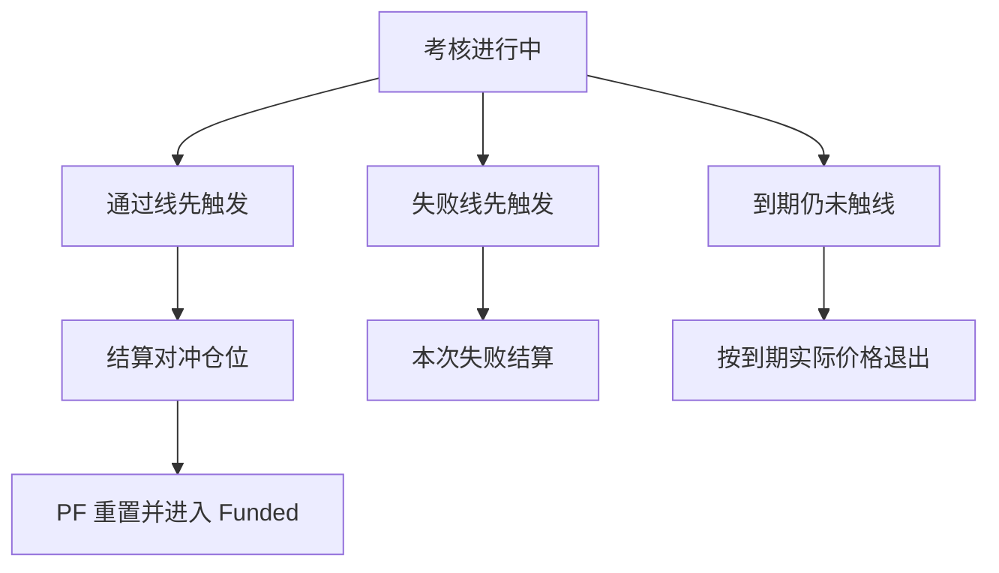

版本：1.2 自动联合求解版。更新日期：2026-11-19。交付对象：Codex。用户确认：仓位规模 auto；个人资金口径 both。产品形态：实时行情驱动、自动计算对冲比例与双边目标仓位的只读决策工具。

本项目的第一目标是：读取或录入当前真实账户与持仓，结合持续更新的行情，直接计算当前对冲比例、目标总仓位、需要增减的差额，以及相应现金约束。首个交付必须跑通这个实时闭环。数学引擎保持独立纯函数；模拟成交、历史回放和完整交易历史都不是用户开始使用的前置条件。

本版以用户最新明确的“需要实时计算，不要围绕模拟器使用”为产品方向，并保留已确认的两日考核、Funded无盈利目标及80/20全额扣款规则。第0节和第15节取代旧版的模拟优先交付顺序。数学案例用于开发验证，不要求把案例和回放做成日常工作台；本文件不代表已检查或修改用户本地运行的成品。

# 0 实时计算纠偏要求

## 0 1 当前任务

复用已有数学代码，优先修复当前网页的默认入口、数据接入、当前快照录入、自动重算和仓位差额结果。暂停继续扩展模拟开仓、播放行情、闯关回放、反复提款演示等用户界面。已经存在的模拟代码可保留为开发测试工具，从日常主导航移出，不能成为实时计算的依赖。

这是产品要求纠正，不是对127.0.0.1:4181现有页面的已验证缺陷清单。接手代码的Codex应先检查当前源码和运行页面，列出真实实现差距，再按本节改动，不凭空声称原程序缺少某个功能。

## 0 2 用户的正常使用流程

1. 打开网页，默认进入“实时计算”，看到当前数据连接和录入状态，不自动灌入409、10000等演示账户余额。

2. 选择自己当前实际阶段，填写或粘贴VS当前权益与已有持仓；填写Hype公开账户地址读取账户，或手动录入Hype当前真实快照。

3. Hyperliquid行情自动更新。手工当前真实快照可以与实时行情组合，手工输入不等于模拟模式。

4. 默认保持当前PF仓位，计算Hype对应的目标比例、目标数量及相对当前持仓的差额；需要时再切换联合搜索。

5. 输入、行情或账户快照变化后自动重算。无需点击模拟开仓、下一步、开始回放或先生成一条成交记录。

6. 用户在交易平台自行操作后，通过账户同步或确认新的当前快照更新现状，工具再计算下一次差额，不由工具虚构成交。

## 0 3 首屏必须回答的问题

| 问题 | 直接展示的答案 |
| - | - |
| 我现在两边持了多少 | 方向、数量、名义额、当前实际h及数据时间 |
| 按当前资金应对冲多少 | 可行区间、候选h、保护下限与现金/保证金上限 |
| 我现在需要改多少 | PF保持或目标总量、Hype目标总量、增加/减少/保持的差额 |
| 已经挂出的单如何处理 | 已成交仓位与未成交订单分开，避免重复建议相同调整 |
| 为什么这个比例合适或无解 | 约束名称、实算值、要求值和资金缺口 |
| 当前结果有多新 | 行情时间、账户确认时间、推算时间及缺失项分别显示 |

终点现金估算仍然必要：它回答当前仓位若走到失败线或提款参考点会怎样。该计算在后台自动完成并用于解释当前结果，不要求用户操作模拟器。

## 0 4 数据与指标缺失时的处理

比例可以先由当前资金与账户规则计算；输出具体币数/手数与调整差额时，才要求有效数量、合约规格、价格和步长。没有选定或验证合约时，仍可展示资金约束比例，具体执行量标为未验证。

若C_ref未知，允许留空。当前比例、失败覆盖下限、现金上限、可计算的保证金约束、当前可提金额、前向现金变化和仓位差额继续计算；整轮净收益及整轮收益上限显示“缺少本轮起点”。不得自动令C_ref=C_now，更不能要求补做模拟交易。用户若选择“从现在起再增加多少资金”，另建明确的分析基准，不能冒充历史本轮基准。

没有完整持仓信息时，未知仓位不能默认为零。没有已知考核开始/截止时间时显示“截止时间未录入”，不能从打开工具的时刻重新开始48小时倒计时。用户提款目标、固定失败线和已确认C_ref不随行情自动移动。

## 0 5 最先通过的实时验收

| 编号 | 验收动作 | 期望 |
| - | - | - |
| R01 | 首次打开首页 | 默认实时计算；无假余额、无自动模拟仓位；明确数据来源 |
| R02 | 不连接钱包，输入当前真实VS/Hype权益 | 立即得到资金约束比例；不用生成模拟成交 |
| R03 | 导入已有双方持仓并固定PF | 输出当前h、Hype目标数量与有符号差额；无需重放历史 |
| R04 | 收到新行情、账户更新或编辑快照 | 自动重算并展示所用快照时间；不靠播放/单步 |
| R05 | 只有手工账户快照但有实时行情 | 数据源可混合；可验证的权益推算标为估算，不冒充API实时报账 |
| R06 | C_ref或历史成交未知 | 当前计算继续；只有依赖历史的指标显示未知 |
| R07 | 发现未成交调整单 | 当前h只按已成交仓位；展示订单及其条件影响，不重复建议同一增减量 |
| R08 | API断开或报价过期 | 保留最后值并标过期；不悄悄用Mock价格替代；未验证部分不显示完成验证 |
| R09 | 在平台实际调整后同步新快照 | 当前仓位和调整差额随之更新；预览从未改动真实快照 |
| R10 | 到期、到目标或有分成待到账 | 保持实时监控，提示当前待处理事项，不自动平仓、重置或预支分成 |

此组R验收是本次交付的首要标准。后文M/F数值和A约束测试用于确保结果正确，不能用“回放已经能跑通”替代此实时闭环。

## 0 6 自动联合求解规格（用户已确认：auto + both）

### 用户选择

- 仓位规模：**auto**。在所有硬约束内自动搜索可行的最大总仓位，不要求用户预先输入 PF 名义额、比例或手数。

- 个人资金口径：**both**。本金保护/累计回收统计可计入 Hype 账户资金与其他个人账户中已经实际到账、可证明归属的资金；但外部钱包、Vest Primary Account、在途资金和未到账分成均不能当作 Hype 可用保证金。Hype 可开仓与强平检查只使用 Hype 实际可用抵押品和对应资金池。

### 自动求解的变量与默认策略

求解器同时搜索：

- PF 目标总仓位及方向（包括 0 仓位）；

- Hype 目标总仓位及反向方向（包括 0 仓位）；

- 由两边价格盈亏敏感度计算出的实际对冲比例 h；

- 已有仓位下的增仓/减仓差额，而不是把目标总量当作新开仓量。

默认目标是：**在个人资金保护、PF 失败/通过规则、Hype 保证金与强平缓冲、交易成本、数量步长和数据有效性全部满足的候选中，最大化可行的 PF 目标名义仓位；若最大仓位并列，优先最大化最差压力情景下的个人剩余现金，再优先较大的强平价格缓冲，最后选择较低的保证金占用。** 这是“最大可行仓位”目标，不是收益最大化、胜率预测或稳定盈利承诺。用户可切换为“保守现金优先”，但不得暗中改变目标函数。

不能只解一个比例后任意指定仓位。比例与规模必须联合求解：比例约束决定双边相对敞口，账户保证金与风控上限决定绝对规模。

### both 资金口径的精确定义

- `C_hl`：Hype 当前真实账户权益/可用资金，依账户模式与资金池计算。

- `C_external`：其他个人账户中已到账、已确认归属的资金。

- `C_in_transit`：已发起但未到达目的地的资金。

- `P_receivable`：已产生但尚未到账的分成。

- `C_protect = C_hl + C_external`：用于评估整个个人资金保护/累计回收的口径；如果外部资金的归属、可取性或币种估值未知，则只计已确认部分，并把未知额单列。

- `C_margin_hl`：Hype API 返回且扣除现有仓位、挂单占用后的真实可用抵押品，只用于 Hype 开仓、维持保证金和强平检查。

- `C_external`、`C_in_transit`、`P_receivable` 一律不加到 `C_margin_hl`。即使外部资金计入保护本金，也不能用它伪造 Hype 保证金。

- PF 虚拟权益始终独立，不能加入任何个人现金口径。

### 自动求解步骤

1. **校验输入。** 检查两边行情新鲜度、账户快照时间、阶段与规则版本、价格映射、合约乘数、结算币种/汇率、数量步长、最小名义额、费率、保证金模式及现有挂单。未知持仓不能当成空仓；用户明确确认空仓才可记为数量 0。

2. **计算当前暴露。** 由已成交仓位和各自标记价/合约规格计算 PF 与 Hype 的有符号名义额、共同价格因子盈亏敏感度、当前实际 h、现有保证金占用。未成交订单单独作为待成交情景，不计入已成交 h。

3. **生成仓位候选。** 从 0 到各平台规则允许的最大数量，按各自合法数量步长生成候选总仓位。上限取以下限制的最小值：平台最大仓位/杠杆规则、真实可用保证金、用户配置的最大保证金占用率、现金留存、其他仓位及挂单占用、最小强平缓冲、价格压力测试、合约/交易时段限制。不得把交易所最大杠杆直接等同于建议杠杆。

4. **联合枚举/优化。** 对每个 PF 目标总仓位候选，计算其价格盈亏敏感度；在 Hype 合法数量网格上搜索反向目标总仓位。每个候选按实际数量重新计算 h、开平/差额调仓费、盘口吃单滑点、汇率与基差压力、失败端/通过端现金、初始保证金、维持保证金及强平价。已有仓位只对差额收取新成交成本。

5. **硬约束过滤。** 依次检查：(a) 个人资金保护：VS 失败结算后 C_protect 达到用户设定的本金及历史成本回收要求；(b) Hype 资金生存：成功/提款路径中，分成到账前 Hype 现金和保证金始终足够；(c) VS 规则：固定失败线、考核通过线、Funded 失败线和可提款基线；(d) Hype 初始/维持保证金、其他持仓共享占用和清算缓冲；(e) 双边费用、盘口深度、滑点、基差及数量取整；(f) 数据来源与新鲜度。任何硬约束失败的候选都淘汰，并列明实际值、要求值和缺口。

6. **排序并输出。** 在剩余候选中按“最大 PF 可行总名义额 → 最差压力情景个人现金较高 → 强平缓冲较大 → 保证金占用较低”排序。输出第一候选、前若干候选、可行区间/离散点集，以及至少一个被淘汰候选和原因。若没有候选，显示无解，不回退到固定 10%、20%、50% 或任何历史示例比例。

7. **实时重算。** 任一有效报价、账户快照、挂单、规则、费率或用户输入变化，自动以最新 stateVersion 重新求解；旧异步结果不得覆盖新结果。若变化只影响价格而不影响可行性，允许保持原仓位，不为制造动态效果强制调仓。

### 两日考核与自动规模的边界

- 两日截止时间是硬性期限：到期后停止给出新增开仓目标，显示当前持仓的退出待处理状态；只读工具不替用户平仓。

- 仅凭当前价格、资金规则和保证金，**无法推导两日内必然触及通过线或失败线**。仓位规模放大只能改变给定价格变动下的盈亏速度，不能保证未来价格变动。

- 如用户希望评估“两日内达到 12,000U 所需仓位”，必须另行提供可审计的压力情景输入，例如“假设两日内标的向有利方向变动 x%”；求解器据此计算达到目标所需的最低 PF 名义额，并与最大可行名义额比较。该结果标为条件情景，不得称为预测、概率或保证。

- 没有用户给定的两日价格压力幅度时，系统仍自动求出**资金与风险约束下的最大可行仓位**，但明确显示“未验证两日触线可达性”。不得通过偷偷假设波动率、收益率或历史胜率填补。

- 到期未触线按到期时真实可观察的双方报价和实际仓位结算；不能把剩余亏损空间 D 当作已经发生的 PF 盈亏，也不能当成 Hype 已实现盈利。

### 页面必须新增/改写的输入和输出

- 资金设置：个人本金保护基准、已到账外部资金、外部资金币种/估值、在途资金（仅展示）、Hype 可用抵押品（优先 API）、最低现金留存、每边最大保证金占用率、最低强平价格缓冲。

- 自动规模设置：默认“自动最大可行仓位”；可选“保守现金优先”；可选两日压力幅度（不填则不做两日可达性判断）。

- 首屏输出：当前 h、可行 h 区间/离散候选、PF/Hype 目标总名义额、两边目标数量、两边需增减数量、占用保证金、失败端个人资金、成功端到账前 Hype 现金、到账后个人资金、强平缓冲、两日可达性状态。

- 资金展示必须并列呈现“个人保护资金 C_protect”和“Hype 可用保证金 C_margin_hl”，不允许合并成一个“可用资金”数字。

### 自动求解状态

`AUTO_FEASIBLE`：至少一个候选通过全部硬约束；\
`AUTO_PARTIAL`：资金比例可算，但某些保证金/合约/价格数据未知；\
`AUTO_INFEASIBLE`：完整搜索范围内没有候选通过；\
`AUTO_DATA_BLOCKED`：行情或账户快照过期/关键输入缺失，不能给出当前建议；\
`AUTO_DEADLINE_EXIT_REQUIRED`：两日截止已到，停止新增仓位建议；\
`AUTO_HOLD`：当前仓位仍在可行区间，建议保持，不需要调仓。

### 新增验收

| 编号 | 验收动作 | 期望 |
| - | - | - |
| AUTO01 | 用户选择 auto + both，双方空仓且输入当前权益/规则/保证金 | 不要求填写 PF 名义额或 h；自动生成合法候选并给出最大可行仓位及比例 |
| AUTO02 | C_external 增加 100U，C_hl 不变 | 失败保护/个人回收口径可变化；Hype 保证金上限不得增加 |
| AUTO03 | Hype 可用保证金减少 | Hype 目标仓位上限下降或无解；不得用外部资金补成可用保证金 |
| AUTO04 | VS/Hype 合约乘数、报价币种或汇率不同 | 按共同价格因子盈亏敏感度换算；不能按名义额直接假定 1:1 |
| AUTO05 | 当前已有仓位 | 自动求目标总量，并输出目标减当前的有符号差额；仅差额产生新费用 |
| AUTO06 | 没有两日价格压力输入 | 仍计算最大可行仓位，但两日可达性显示“未验证”，不得声称两天能通过 |
| AUTO07 | 输入两日有利价格变动压力幅度 | 计算所需 PF 名义额，并与最大可行额比较；结果明确标为条件情景 |
| AUTO08 | 任一关键行情或账户快照过期 | AUTO_DATA_BLOCKED，保留最后数据但暂停仓位建议，不显示可交易 |
| AUTO09 | 当前仓位满足约束且没有改善空间 | AUTO_HOLD，建议保持，不产生虚假的调仓差额 |
| AUTO10 | 所有候选因保证金/失败保护/强平缓冲淘汰 | AUTO_INFEASIBLE，展示具体缺口，不退回固定比例 |
| AUTO11 | 账户有外部已到账资金与 Hype 账户资金 | 个人保护口径可合并；Hype margin 只使用 Hype 实际抵押品 |
| AUTO12 | 搜索边界、数量步长和最大仓位限制 | 对所有合法离散候选复核；未穷尽时只能说“搜索范围内未找到”，不能宣称数学上无解 |

## 0 8 杠杆必须由求解器推导，不是用户预设输入（本次页面复查）

### 用户明确要求

杠杆倍数不是用户预先指定的策略参数。用户选择的是 `AUTO` 仓位规模与 `BOTH` 个人资金口径；程序必须把**目标名义仓位、实际杠杆/保证金档位和对冲比例作为联合求解变量**。不得要求用户在“开考前资金规划”中填写 Hype 规划杠杆，也不得把默认 1x 当成推荐结论。

### 必须区分的杠杆概念

- `exchangeMaxLeverage`：交易所/合约对当前账户和仓位档位允许的最大杠杆，是硬性上限，不是建议值。

- `configuredLeverage`：账户当前真实设置的杠杆，仅在 API 能可靠读取时显示为“当前设置”；不能冒充自动建议。

- `candidateLeverage`：求解器为某个候选仓位测试的杠杆档位。

- `requiredInitialMargin`：候选仓位按该杠杆和交易所档位要求的初始保证金。

- `maintenanceMargin` 与 `liquidationPrice`：根据账户模式、仓位、其他仓位、抵押品、风险档位和交易所规则计算或读取的维持保证金与强平价。

- `effectiveLeverage`：名义敞口 / 对应账户权益（须明确分子分母口径），用于风险展示，不等同于用户在 UI 中设置的杠杆档位。

### 自动杠杆求解流程

1. 先由资金规则与失败/成功现金约束求出双边可行价格盈亏敏感度比例范围；再联合搜索 PF 和 Hype 的合法数量。

2. 对每个仓位候选，枚举该合约/账户模式允许的合法杠杆档位（至少覆盖 1x 至交易所档位上限，或使用单调性有证明的数值搜索），重新计算初始保证金、维持保证金、清算价、压力价格下的权益与剩余保证金。

3. 任何候选只要在 VS 失败/通过压力路径、用户设置的跳价与延迟压力、持有期间资金费压力或盘口退出成本下，先触及 Hype 清算条件，或低于用户要求的强平缓冲/最低保证金余量，即淘汰。

4. 在通过全部硬约束的组合中，按用户已选目标排序：先最大化可行 PF 名义额；并列时最大化最差压力情景个人剩余现金；再优先更大的清算价格缓冲、更低的保证金占用；仍并列时选择**较低的杠杆档位**。因此不会为了最大名义额而无条件使用交易所最大杠杆。

5. 如果某仓位只有高杠杆才能满足初始保证金，但该杠杆导致强平缓冲不合格，则该仓位必须淘汰并继续搜索更小仓位；不能仅提示用户提高杠杆。

6. 输出“求解建议杠杆”和“当前账户杠杆设置”两栏。建议杠杆只是一项计算结果；本项目只读，不修改交易所设置、不自动下单。用户在平台自行调整后，重新读取/确认账户状态再计算。

7. 如交易所 API 无法读取账户当前杠杆或完整保证金模式，允许对候选档位作条件计算，但标记 `LEVERAGE_UNVERIFIED`，不得显示“实盘已验证”。不得把用户手填的杠杆当成自动求解的必要输入。

### 当前页面中必须删除/改造的控件

- 删除“开考前资金规划 → Hype 规划杠杆（倍）”必填/可编辑输入。

- 删除“计算条件 → Hype 当前杠杆倍数”作为求解器必填输入。若保留，只能作为可选的“当前账户实际杠杆设置（用于对照）”，不参与定义建议比例；缺失时由求解器枚举合法档位。

- 删除“按双方全仓、空仓且无挂单计算”作为静默默认。账户模式、空仓和挂单状态必须由当前快照或用户明确确认。

- 把“全仓 1 倍”从推荐结果中移除，除非它确实是 API 读到的账户当前设置，且标注为当前设置而非建议杠杆。

- 结果卡新增：建议杠杆档位、交易所允许最大杠杆、该候选初始保证金、压力后剩余保证金、维持保证金、清算价来源、清算缓冲，以及“为什么该杠杆而不是更高/更低”的解释。

- 在候选表中每一行都必须同时展示 PF 名义额、Hype 名义额、h、Hype 候选杠杆、初始保证金、压力后最低保证金余量和清算缓冲；不能把杠杆固定为一个全局输入后再只搜索 h。

### 本次读取到的页面实际问题

当前页面仍显示“开考前资金规划 → Hype 规划杠杆（倍）”输入，计算条件里也有“Hype 当前杠杆倍数”输入；页面说明“按双方全仓、空仓且无挂单计算”，并展示“全仓 1 倍”。这与用户选择 AUTO 的要求不符。当前显示的 PF 2028.36U / Hype 308.61U / h 15.234% 是预设资金规划、零压力配置下的条件候选，不是用户真实账户的实时建议。压力项仍显示未配置，故不能当作完整风险验证。

### 新增验收

| 编号 | 场景 | 期望 |
| --- | --- | --- |
| LEV01 | AUTO 模式首次打开 | 不要求输入规划杠杆或当前杠杆；求解器自动枚举合法杠杆档位 |
| LEV02 | 同一目标仓位测试多个杠杆 | 每个档位独立计算初始保证金、维持保证金、清算价和压力后权益 |
| LEV03 | 最大交易所杠杆下清算缓冲不足 | 淘汰该档位，继续搜索较低仓位/其他杠杆，不得推荐最大杠杆 |
| LEV04 | 较低杠杆仍满足所有约束 | 并列时优先较低杠杆 |
| LEV05 | API 未提供当前杠杆设置 | 仍可做条件求解；标记当前设置未知，不要求用户手填才可运行 |
| LEV06 | API 未提供完整账户模式/维持保证金参数 | 标记 LEVERAGE_UNVERIFIED，不输出完整实盘可行结论 |
| LEV07 | 用户在交易所自行改变杠杆 | 新账户快照触发重算；工具不修改账户设置 |
| LEV08 | 候选杠杆档位与仓位数量取整 | 每个最终合法数量重新计算保证金和清算价，不能沿用连续解 |

## 0 9 最新页面复查：杠杆选择与状态一致性（2026-11-19 20:43）

本节基于当前浏览器页面 `http://127.0.0.1:4181/` 的只读内容。没有修改本地应用源码。

### 当前进步

- 已删除可见的“规划杠杆”输入；结果区出现“建议杠杆”与“当前账户设置未知”两个独立字段。

- 已显示候选杠杆档位表，包含初始保证金、维持保证金、压力后权益、强平价。

- 页面已输出 AUTO 联合搜索结果、离散比例点、目标仓位和调仓差额。

- 页面已明确标注“预设资金规划”“条件方案”“账户设置未验证”“压力未配置”，不再把该结果直接伪装成真实账户数据。

### 当前数值结果（仅预设资金条件，不是实盘建议）

- 个人起始本金 500U，报名费 91U，规划 Hype 起始资金 409U；VS 起始权益 10,000U。

- 首选候选：PF 空 6,956.69U，Hype 多 1,069.93U，h=15.394%；成功端到账前 Hype 现金 100U，失败端个人资金 500U。

- 页面推荐 40×，对应初始保证金 26.75U；但候选杠杆表显示 4× 至 40× 均“通过所设条件”，且维持保证金 13.37U、压力后权益 100.45U、最低维持余量 90.93U、预计强平价 39,915.57 全部相同。

- 3× 被淘汰原因是“调仓后可用抵押品留存”；4× 是首个显示通过的档位；4×到40×之间没有显示任何额外清算缓冲或现金收益改善。

### 必须修复：当前 40× 推荐与优化目标冲突

现行规格说在仓位、现金与强平缓冲相同的情况下优先较低杠杆；当前页面却选择40×，只因它使用更少初始保证金。对当前全仓模型而言，页面显示4×至40×的压力后权益、维持保证金和清算价完全相同，所以40×没有增加风险缓冲或改善成功/失败端现金，只是把更多资金显示为可用保证金。**在其他风险指标相同的前提下，应选择最低的可行杠杆档位，本例应选择4×而不是40×。**

杠杆排序修正为：

1. 先最大化符合硬约束的双边仓位规模；

2. 同规模下最大化最差压力情景个人剩余现金；

3. 满足用户设定的最低清算缓冲后，优先更大的实际清算缓冲；

4. 若不同杠杆档位的真实清算价、维持保证金余量、压力后权益与费用均相同，优先**最低可行杠杆**；

5. 不得单纯因初始保证金较少就把最大杠杆当作推荐。若较高杠杆确实能改善某个真实硬约束，必须显示具体改善量及其代价。

### 必须修复：全仓杠杆档位表解释不足

- 全仓模式下，杠杆设置可能影响初始保证金/可开仓能力，但强平价格取决于账户权益、全仓抵押品、所有仓位、维持保证金档位和费用。若不同杠杆设置计算出同一清算价，页面必须解释这是该账户模式的模型结果，不得把“杠杆越高”暗示成“强平越安全”。

- 必须将“初始保证金需求”“已占用保证金”“账户可用保证金”“有效杠杆（总名义额/权益）”“交易所设置杠杆”分开显示。

- 候选档位若只影响初始保证金而不改变清算价，应在表头或说明中标注“清算模型对杠杆设置不敏感（当前全仓模型）”，并解释档位仅改变初始保证金要求。

- 若 API 未提供实际账户设置，结果继续标记 LEVERAGE_UNVERIFIED；不得把候选档位说成交易所已经应用的杠杆设置。

### 必须修复：AUTO_FEASIBLE 过度乐观

页面目前同时显示：

- `AUTO_FEASIBLE`

- `压力未配置：基差及汇率、跳价、调仓延迟、资金费`

- `条件方案`、`账户设置未验证`

这种状态容易让用户误读为完整可行。规则应明确：

- `AUTO_FEASIBLE` 只允许在所有必要行情、账户、合约、保证金模型和用户要求压力项均已验证时使用。

- 若资金/基础费用约束有解，但压力项未配置或账户杠杆设置未核实，状态必须为 `AUTO_PARTIAL`，并把基础候选与未验证条件分别展示。

- `AUTO_FEASIBLE` 不等于盈利保证，只表示已配置的全部约束均通过。

- 页面主 badge 应显示 `AUTO_PARTIAL · 条件方案`，不能让“基础候选通过”覆盖缺失压力项。

### 必须修复：资金口径和结果表述

- 当前“成功端个人资金100U”是到账前 Hype 现金，不是全部个人资产，也不是整轮总收益；标题应改为“成功端 Hype 现金（分成到账前）”。

- 当前“失败端个人资金500U”应拆分为 Hype 结算现金、外部已到账资金、合计个人保护资金；不要把所有资金统称为 Hype 现金。

- 当前“通过后个人资金”与“成功端到账前 Hype 现金”并列时需说明当前为考核阶段、考核利润不可分，不能把预计提款分成加进去。

- “最大可行 PF 仓位”是按当前选定的价格路径、规则、费用和压力假设求出的条件最大值；没有两日价格变动输入时仍显示“两日可达性未验证”。

### 新增验收

| 编号 | 场景 | 期望 |
| --- | --- | --- |
| LEV09 | 全仓账户中4×至40×的清算价、维持保证金和压力后权益相同，均满足条件 | 选择最低可行档位4×，不能因初始保证金最低而选40× |
| LEV10 | 提高杠杆只减少初始保证金，但不改善清算缓冲/现金结果 | 显示只是释放初始保证金占用，不把它描述为风险改善 |
| LEV11 | 杠杆表多档均通过，但清算指标相同 | 明确解释全仓模型中杠杆档位的影响边界，优先最低可行杠杆 |
| STATE01 | 压力未配置、杠杆设置未验证，但基础资金候选有解 | 状态为 AUTO_PARTIAL，不得显示完整 AUTO_FEASIBLE |
| STATE02 | 失败端结果同时含 Hype 与外部资金 | 分项展示并避免把外部资金标为 Hype 现金 |
| STATE03 | 当前为考核阶段 | 考核利润分成显示不可分；成功端只展示实际 Hype 现金与条件估算，不预支提款 |

## 0 10 最新页面复查：AUTO_PARTIAL、双方案和剩余问题（2026-11-19 21:37）

本节基于当前选中浏览器标签 `http://127.0.0.1:4181/#current` 的只读页面内容。页面已刷新到新的求解版本；本节是审查记录与后续开发要求，不代表已修改本地应用源码或完成真实账户验证。

### 当前已修正

- 推荐杠杆由上一版40×改为4×，并标记“4×是该仓位的最低可行档位”。

- 1×至40×杠杆表显示初始保证金随档位变化，而当前全仓模型下维持保证金、压力后权益和强平价相同；页面解释了清算模型对杠杆设置不敏感。

- 已把“有效杠杆 2.598×”与“建议杠杆 4×”分开。

- 状态已改为 AUTO_PARTIAL，并列出压力未配置、账户资金来自预设、实际账户杠杆/调档额度待核实。

- 个人保护资金显示分项：失败端 Hype 结算现金500U、外部已到账0U、合计500U；成功端 Hype 现金100.04U。

- 已加入“最大可行方案”与“保守推荐方案”对照。

- 已显示行情与求解版本标识，并提供保存本次核算 JSON 的入口。

### 当前页面显示的条件结果

- 最大可行方案：PF 多 6,917.39U，Hype 空 1,062.57U，h=15.374%，建议档位4×；失败端个人保护资金500U，成功端到账前Hype现金100.04U。

- 保守方案：PF 多764.35U，Hype 空115.94U，h=15.181%，条件档位1×；失败端个人保护资金500U，成功端到账前Hype现金105.05U。

- 两方案都来自预设资金规划：个人本金500U、报名费91U、Hype规划起始资金409U、VS规划起始权益10,000U；不是实际账户持仓建议。

- 两日条件可达性未验证；基差/汇率、跳价、调仓延迟、资金费压力未配置；当前账户杠杆设置、真实账户权益/持仓/挂单也未验证。

### 后续必须优化

1. **最大方案与保守方案的优化目标要量化解释。** 当前保守方案把PF仓位从6,917.39U降到764.35U（约减少89%），成功端现金只从100.04U提高到105.05U（增加约5.01U）。页面必须展示牺牲的PF名义额和换来的现金缓冲，让用户判断这种权衡是否值得；不能只贴“保守推荐”标签。

2. **最优解用语必须限定搜索域。** 改成“在当前输入、已枚举数量网格、已配置约束及当前市场快照下，搜索范围内最优”。未验证项继续附条件标识。

3. **1×保守候选必须核对真实交易所档位。** 账户模式/当前设置未读取时，标为条件候选；不能写成实际账户已经使用1×。区分交易所允许档位、候选所需档位、账户当前设置。

4. **全仓清算模型需要独立核验。** 清算价需基于真实账户模式、所有仓位、抵押品、维持保证金档位及费用，并与API参考清算价/账户状态对照。账户模式、其他仓位或抵押品不完整时，只能标为条件估算。

5. **PF与Hype保证金分开展示。** PF是模拟账户，PF保证金与Hype真实抵押品不是同一资金池。不得把两者相加后与个人409U比较。分列PF模拟保证金、Hype真实初始保证金、Hype其他占用和Hype剩余可用抵押品。

6. **未配置压力时不得称“压力后权益”。** 当前压力未配置却显示压力后权益100.69U、路径最低余量83.56U。应改名为“基础情景（未计未配置压力项）权益/余量”；只有实际配置压力才使用“压力后”。

7. **报价时差与快照时差统一熔断。** 显示最大允许时差、两边时间戳、报价年龄和账户快照年龄。超过阈值停止完整建议；成交盘口过期时不输出可执行调整量。

8. **结果版本必须一致。** 每张结果卡显示相同的报价版本、账户快照版本、规则版本和求解版本。价格已更新而候选仍来自旧行情时必须提示并停止建议。

9. **预设规划与真实账户视觉隔离。** 切换到真实账户模式时，预设空仓/权益不得继承；真实账户字段缺失时AUTO_DATA_BLOCKED。

10. **全账户空仓确认需拆分。** 分别确认VS空仓、Hype空仓、VS无挂单、Hype无挂单、两边保证金模式。全选操作需二次确认并记录时间；未确认的仓位不能默认为0。

11. **加入调仓迟滞阈值。** 行情轻微抖动不应让合法数量步长在相邻档位间反复切换。显示“变化低于最小调仓阈值，建议保持”，仅过滤建议，不自动交易。

12. **明确保守方案目标函数。** 说明它究竟最大化哪个现金指标；失败端保护仍是硬约束。不能笼统声称整体风险更低。

13. **两日考核显示真实截止时间。** 没有用户确认的开始/截止时间时显示未配置，不从打开页面时间自动推算。

14. **区分当前h与候选h。** 双边空仓时当前实际h显示“不适用/无现仓”；候选目标h单独显示15.374%。

15. **失败端500U是条件结算结果，不是当前余额。** 命名为“失败线触发并完成两边平仓后的条件现金”，分列Hype预计结算余额与外部已到账资金，并解释当前409U到条件500U的假设盈亏桥接。

16. **AUTO_PARTIAL提供缺失项清单和定位。** 列出账户快照、杠杆设置、账户模式、基差压力、跳价压力、延迟压力、资金费压力、两日截止时间等缺失项，并提供跳转入口。

### 新增验收

| 编号 | 场景 | 期望 |
| --- | --- | --- |
| OPT01 | 最大方案与保守方案对比 | 显示PF仓位牺牲金额/百分比与现金缓冲增加额 |
| OPT02 | 页面标注搜索最优 | 明确当前输入、数量网格、规则版本和搜索边界 |
| OPT03 | PF与Hype保证金展示 | 分开显示，不跨资金池相加 |
| OPT04 | 压力未配置 | 只显示基础情景，不显示“压力后” |
| OPT05 | 报价时差超阈值 | 停止完整仓位建议并显示熔断原因 |
| OPT06 | 账户模式或其他仓位未知 | 清算价标条件估算/无法验证 |
| OPT07 | 当前空仓 | 当前h显示不适用，目标候选h独立显示 |
| OPT08 | 预设规划切换真实账户 | 隔离预设数据，缺字段时AUTO_DATA_BLOCKED |
| OPT09 | 轻微行情波动 | 迟滞/调仓阈值防止建议抖动，不自动交易 |
| OPT10 | AUTO_PARTIAL | 展示未验证项清单并可定位设置 |
| OPT11 | 两日截止时间缺失 | 不显示倒计时或两日通过能力结论 |
| OPT12 | 资金桥接 | 当前409U与失败端条件500U之间的假设盈亏路径可审计 |


# 1 给 Codex 的执行要求

请在当前项目上纠正产品流程，不另起一个与真实状态脱节的演示页面。

1. 先阅读仓库指引和现有代码，实际打开运行页面，检查默认路由、状态来源、行情适配器、求解触发和结果面板，保留已有可用代码。

2. 第一个用户可用闭环同时包含：当前真实快照输入、当前行情接入、独立计算函数、自动重算和目标仓位差额。数学单元测试并行建立，不先把全部模拟账本做完才接实时数据。

3. 默认提供已确认的规则参数，不把规则默认值当作实际账户余额。初次未连接账户时用空状态引导输入，演示数据仅在明确测试入口加载。

4. 默认采用用户已确认的 auto 模式：双方联合自动搜索可行的最大总仓位与对应比例；不要求用户预先输入 PF 名义额或 h。仍支持固定 VS、固定 Hype 两种手动约束模式。自动目标函数、both 资金口径和两日可达性边界详见第 0.6 节。

5. 手工录入的当前真实状态与API行情允许组合。无完整历史、无钱包地址或缺某项参数时，继续显示可以计算的结果，准确标记受影响项。

6. 主标识为“实时只读计算 · 不自动下单”。只读限制交易执行，不限制真实行情、真实账户读取和当前调整建议；不读取私钥，不实现真实交易或划转。

7. 所有预测只在快照副本上运行，不生成用户需要推进的模拟成交。不重写真实快照、不预支提款、不把尚未执行的建议当成真实持仓。

8. 先完成R01—R10，提交实际页面与数据证据，再完善费用、保证金和UI。不要继续把开发时间优先投入模拟回放。只本地交付，不部署公网，不发送外部消息。

# 2 默认业务规则及来源

## 2 1 用户确认的计算情景

所有金额先以统一记账单位 U 表示；实盘接入后同时保留实际币种，USDC、USDT、USD 不得未经汇率处理直接混用。

| 参数 | 默认值 | 约束 |
| - | - | - |
| 个人初始总资金 B | 500U | 已包含报名费 |
| 单次考核购买费 | 91U | 新购一次扣一次，不按行情刷新或每笔交易重复扣 |
| 初始 Hype 现金 | 409U | 500 − 91 |
| 考核 PF 起点 | 10,000U | PF 账本不属于个人实盘抵押品 |
| 考核通过线 | 12,000U | 以配置的 PF 自身净结算口径判定 |
| 考核固定失败线 | 9,400U | 初始亏损空间 600；不随高点上移 |
| 考核利润 | 不可提款 | 通过取得下一阶段账户，不直接产生个人现金 |
| 考核期限 | 两日结束本次尝试 | 见第 8 节的截止口径和到期处理 |
| 通过后 PF 起点 | 10,000U | 仅重置 PF 阶段账户，实盘与历史费用延续 |
| Funded 固定失败线 | 8,000U | 按用户给定模型；初始亏损空间 2,000 |
| Funded 强制盈利目标 | 无 | 用户设置的 E_target 是提款参考点 |
| 利润分配起点 | 10,000U | 低于此线的恢复收益不能提款 |
| 用户分成 | 80% | 平台分成 20% |
| 分配扣款 | PF 扣除全部已分配毛利润 | 10,100 分配 100 后 PF 回到 10,000；用户 80，平台 20 |
| 下一轮利润起点 | 10,000U | 本模型保持固定，不抬成 10,100 |
| VS 默认单边手续费率 | 0.0001，即 0.01% | 模拟参数，可编辑，不冒充实际账户费率 |
| Hype 默认单边手续费率 | 0.0005，即 0.05% | 模拟参数，可编辑，不冒充实际账户费率 |

Funded 默认演示参考点为 10,100；它不是平台的盈利目标。支持在每次利润实际到账后，以同一固定起点规则继续进行下一轮条件推演。

演示配置默认 `passTrigger="net_settlement"`、`failureTrigger="net_settlement"`，与本文精确数值用例保持一致；这不是对实际平台触线口径的确认。实际账户模式按已验证规则选择口径，并保留切换前后计算差异。

## 2 2 规则与事实必须分层

每个规则记录 `source`、`verifiedAt`、`profileVersion` 和验证状态。默认配置标记 `user_provided`，演示费用、市场参数标记 `simulation_assumption`，真正读取的接口数据标记 `api`。

用户给定的 Funded 8,000 失败线与当前公开标准账户说明并不相同；不得把默认情景标成已核验的 Vest 通用规则，也不得擅自改为其他失败线。两日期限是用户的操作要求。实际平台若还有日亏损、交易时段或其他限制，作为独立规则输入叠加，不将其隐含进固定最大回撤。[S1]

确认状态按结果分别标记，不能阻止已具备输入的当前计算。未验证实际账户规则时可显示条件比例，不能展示“实盘全部条件已验证”；未连接账户时，规则默认数值不自动进入当前真实余额。

# 3 两套账本和资金口径

## 3 1 PF 账户账本

保留 `balance`、`unrealizedPricePnl`、`fundingAccrued`、`feesPaid`、`equityMark`、`equityIfClosed`、`stage`、`positions` 和账户规则。

`equityMark` 是已发生账务调整后的余额加当前浮动盈亏；已经进入余额的手续费或资金费不能再加减一次。

`equityIfClosed` 是从当前状态按指定成交压力平仓后的预计 PF 净值，额外扣除尚未发生的 PF 平仓费用与成交损耗。两种权益口径必须分别显示，禁止混用。

PF 通过、失败和可分利润只根据 PF 自身数据判定。Hype 的费用不从 PF 净值扣除。默认通过和利润申领采用 `net_settlement`；失败判定口径独立配置，并在演示配置中明确设置。

## 3 2 个人真实资金账本

记录报名费、Hype 现金与浮盈亏、Hype 实际交易费用、资金费、真实到账分成，以及个人各资金账户之间的转移。

至少分开以下字段：

| 字段 | 含义 |
| - | - |
| C_hl | 实际位于 Hype、属于相应账户资金池的真实权益 |
| C_external | 已到账、位于其他个人资金账户的余额 |
| transferInTransit | 已从来源扣除但尚未到目的地的已确认转移资产；不作为Hype抵押品 |
| C_total | 去重后的个人经济权益；包含已确认归属的在途转移资产，用于本轮绩效核对 |
| C_protect | 失败结算情景下可纳入本金回收的权益；默认不包括在途资产，基础情景为C_hl + C_external |
| payoutReceivable | 已产生但未实际到账的应收分成；不加入 C_total 或 C_hl |
| B | 本次项目要保住的个人本金基准，默认 500 |
| C_ref | 本轮开始时固定记录的 C_total |
| externalContributions | 额外投入本金；不得当成策略盈利 |
| externalWithdrawals | 真实取出资金；用于累计回收统计，不重复加进外部余额 |

简化界面可先假设全部个人资金都在 Hype，此时 `C_total = C_protect = C_hl = C`。正式数据模型必须支持各口径分离：外部钱包或 Vest Primary Account 的资金不是 Hype 的抵押品。资产归属或可回收性未确认时单列为未知，不算作可用现金。

使用资金转移事件在两个位置之间移动余额，不能在原位置保留余额、又在目标位置增加同一笔资金。来源扣款时原子地移入 transferInTransit，目的地确认到账时原子地冲销在途并入账。没有转账费用或估值变化时，转移前后 C_total 不变；C_hl 和 C_protect 按实际到位情况变化。真实转账费用另记，外部追加本金、取出本金须单独归类。

历史费用已经反映在当前资金中，比较失败端可回收资金与 `B=500` 已包含该历史缺口。不得再把同一历史费用加到 B 上。在途资金单独处理，不被误标为新发生的策略亏损。新购账号会再扣购买费，但不会自动把保护基准从 500 重置为剩余金额。

## 3 3 C_ref 的冻结规则

已有真实本轮基准时导入C_ref并记录来源，之后冻结。用户可以在任意交易中途打开工具，C_ref允许未知；只有整轮增益及依赖它的收益上限不能计算，其他前向现金与持仓计算继续。行情刷新、浮盈变化、调仓、编辑快照都不能自动重置C_ref，不能把未知基准偷偷设成当前权益。

实际完成本轮结算和计划资金到账后，可依据已确认真实事件建立下一轮C_ref。分成待到账期间仍持续读取、监控和计算当前仓位；可用资金仅包括已经到位的资金，不把应收当抵押品。用户使用工具不需要创建或推进模拟轮次。

如果允许轮内外部出入金，本轮策略增益应为 `C_end − C_ref − 本轮额外投入 + 本轮对外取出`，并从个人累计回收与即时可用保证金中分别展示。

# 4 对冲比例定义与合约归一化

对冲比例 `h` 定义为 Hype 反向持仓对共同价格因子的盈亏敏感度，除以 PF 持仓对同一因子的盈亏敏感度。

```text
theta_vs = d(PF 价格盈亏) / d(共同价格因子)
theta_hl = d(Hype 价格盈亏) / d(共同价格因子)
h = abs(theta_hl) / abs(theta_vs)
当h>0时的反向条件：theta_hl × theta_vs < 0
```

共同因子可采用同一标的的标准化价格变动。简单的同标的线性匹配中，PF 价格盈亏为 x，Hype 价格盈亏为 `−h × x`。不同乘数、币种、报价单位和映射关系要先换算，不能直接拿手数或保证金相除。

线性合约的单笔价格盈亏：`有符号数量 × 合约乘数 × 价格变动 × 有效汇率`。不支持的反向、非线性或不可验证映射合约返回 `UNSUPPORTED_INSTRUMENT`。名称相似不证明可对冲。

`h` 不是杠杆倍数，也不是两边保证金的比例。允许 h 大于 1，是否可行由资金和风险约束决定。h=0是显式未对冲候选，仍验证PF自身规则。PF 仓位为零时返回 `HOLD`，比例为 `null`，不做除零运算。

# 5 第一层求解器与可解释公式

## 5 1 成立范围

此层用于解释、零成本基准和人工预算压力测试：从当前状态起，保持所选比例到下一个参考事件；两边价格盈亏线性匹配；D、T 在同一近似口径下计算。它不替代逐笔费用、真实保证金或路径验证。

```text
D = E − floor
T = E_target − E
P = 0                                  // 考核阶段
P = 0.8 × max(E_target − 10000, 0)       // Funded 阶段
```

基础模型用 C 表示个人资金全在 Hype。k 是该互斥终点情景下的未来现金摩擦预算，每个情景各扣一次，不能在同一条真实账本路径重复扣。已计入 C 的历史费用不能再计入 k。

```text
失败端真实资金       C_fail   = C + h × D − k
成功端到账前真实资金 C_before = C − h × T − k
成功端到账后真实资金 C_after  = C_before + P
本轮真实增益         gain     = C_after − C_ref

h_min        = max(0, (B − C + k) / D)
h_max_cash   = (C − R − k) / T
h_max_profit = (C + P − C_ref − g − k) / T
```

Funded 在C_ref已知时的现金可行区间为 `[h_min, min(h_max_cash, h_max_profit)]`。C_ref未知时，利润上限返回null，仍展示保护下限与现金上限组成的部分区间，并标记“整轮利润约束未验证”；不能将这个部分区间说成满足全部盈利要求。考核没有可提利润，不套用本轮盈利上限，只保留通过后续航现金约束。真实执行候选还要通过保证金、步长、规则、数据和路径筛选。

如果个人资金分散在不同位置，保护下限使用 C_protect，本轮增益使用 C_total，到账前 Hype 生存约束用 C_hl。在没有在途转移和其他受限资产时C_protect=C_total。不得以 C_total 替代 C_hl 计算保证金。

下列条件先返回状态，不继续求比值：

- D ≤ 0：失败底线已触及。

- 考核当前终点已达到：进入待结算或已通过状态。

- Funded 的 E_target ≤ 10,000：该参考点无可申领利润。

- E_target ≤ E：参考点已达到；转入当前可申领额检查，不继续新增目标计算。

- h_max < 0 或 h_min > h_max：无可行区间，不将负上限截成零后伪造可行。

- 必需输入缺失、NaN、无穷、无效币种或未支持合约：对受影响结果明确报错，不当成零；C_ref等可选历史字段缺失时按第0节局部降级。

## 5 2 比例选择目标

默认目标是：满足失败端保护要求、到账前现金和保证金约束之后，最大化成功端本轮真实增益。对固定目标、固定 k 的线性模型，优先候选是最低可行 h。成本或约束随 h 改变时，必须在合法离散仓位上重新评估。

```text
gain_max_at_endpoint = C + P − C_ref − k − T × h_min
```

允许切换排序目标，例如两个价格终点的较差现金最大、较低保证金占用或较大清算缓冲。每次展示所选目标、候选范围、约束状态，不无条件称为“最佳比例”。没有概率模型就不输出期望利润或通过概率。

## 5 3 动态更新机制

数据快照、费用、资金到账、目标或规则变化时重算。完美线性且无费用时，单纯价格变化可能让 h_min 保持不变；不为制造“动态”效果而强行调仓。

调整建议必须同时显示 `currentQuantity`、`targetQuantity` 和 `deltaQuantity`。只有差额构成拟交易量；保留中的已有仓位不再次计算开仓费。

```text
C_t = C_0 − sum(h_i × ΔX_i) − sum(本段真实现金费用_i)
      + sum(实际到账分成_i) + 外部净入金
```

这里 ΔX_i 是该段匹配的 PF 价格盈亏分量。不能用最后一个 h 乘全部历史 PF 净值变化。最终账务以逐笔成交、费用、资金费和资金转移事件为准。

# 6 第二层精确费用与终点反解

## 6 1 成交与成本原则

每次开仓、增仓、减仓、反手和平仓按实际成交名义额独立计费。平仓名义额随价格变化，不能一律用开仓名义额乘以两倍费率。每次计算明确快照基准：`flat_before_entry`、`open_mark_snapshot` 或 `settlement_snapshot`，不允许不标口径的权益进入精确费用公式。

如果使用真实 bid/ask 和盘口深度生成成交价，点差已进入盈亏，不再额外扣同一笔点差。若使用中间价估算，必须显式加入成交偏移并保持两套路径一致。资金费根据事件时间和实际仓位累计，不能把当前费率当作未来不变的事实。

预测费用与实际费用分开。实际成交回执已包含的费用不再加收。Hype 费用需保留 feeToken、rebate 和数据来源；平台回执中的已含附加费不重复累加。[S2][S3]

## 6 2 新建一组线性仓位的解析基准

仅适用于：两边开仓前为空仓，N 是 PF 开仓名义额，d=+1 表示 PF 做多、d=−1 表示 PF 做空；两边价格同比例变化；一个开仓和一个平仓；无资金费、基差、滑点和中途调整。当前 E、C 取开仓费发生前快照。

```text
fV = PF 单边费率
fH = Hype 单边费率
x  = PF 毛价格盈亏
y  = PF 从开仓前到平仓后的净盈亏

PF 平仓名义额 = N + d × x
y = x − fV × (2N + d × x)
x = (y + 2 fV N) / (1 − d fV)

K_new(y; N, d) = ((1 + d fH) × y + 2N × (fV + fH)) / (1 − d fV)
Hype 真实资金变动 = −h × K_new(y; N, d)

A_fail    = −K_new(−D; N, d)
A_success =  K_new(T; N, d)
```

A_fail 表示每一单位比例在失败终点带来的 Hype 净回收，A_success 表示每一单位比例到成功终点的 Hype 净损耗。这是扣费后的单位比例现金流，不是 PF 的虚拟本金。

如果 A_fail > 0 且 A_success > 0，并且没有其他未计入的固定成本，可以用以下区间作为解析候选：

```text
h_min        = max(0, (B − C_protect) / A_fail)
h_max_cash   = (C_hl − R) / A_success
h_max_profit = (C_total + P − C_ref − g) / A_success   // 仅 Funded
```

已精算的费用不得同时放入 k 再扣一次。仍有额外固定压力成本时分别记录失败端、成功端和 Hype 现金池的未来成本。A_fail ≤ 0 时，增加反向仓位不产生预期失败补偿：返回具体约束或进入通用情景求解，禁止除以非正数。

校验 `1 − d fV > 0`、反解价格为正、`N + d x > 0`。PF 做空的净收益有价格下限，不能产生负价格的“目标解”。解析式是精确引擎的校验基准，不覆盖实际所有交易场景。

## 6 3 已有仓位的处理

当前 mark 权益已经包含开仓费时，从现在到平仓只计未来费用。若当前名义额为 N_current，且保持当前两边数量不变，可用以下只含一次未来平仓费的基准：

```text
K_existing(y) = ((1 + d fH) × y + N_current × (fV + fH)) / (1 − d fV)
```

这里 y 是从当前 PF mark 权益到最终净结算权益的变化；C 也必须是当前 Hype mark 权益。开仓前基准与已开仓基准不可交叉套用。

只要涉及差额调仓、部分平仓、反手、不同历史成本价、双边不同价格或跨币种结算，使用逐笔模拟器：复制当前快照，模拟差额成交，计算新权益，反解 PF 终点，再模拟两边未来平仓。不得通过重复扣开仓费来“保守估计”。

# 7 第三层仓位搜索与风险验证

对每个 PF 总目标仓位 N 和方向，生成 Hype 合法总目标仓位。h 是两者换算后的结果，搜索可以使用解析界、分段求根和合法步长枚举。

```text
validate inputs and source freshness
handle terminal and deadline states
include HOLD candidate
for each explicitly supplied reference equity (challenge has only 12000):
  for each PF target position within capital and rule limits:
    apply proposed PF delta fills on a cloned state
    solve PF failure and reference settlement prices
    obtain analytical hedge bounds where supported
    generate Hype target quantities on the valid quantity grid
    for each Hype target quantity:
        apply Hype delta fills on the same candidate state
        recompute actual h, both ledgers, and cost forecasts
        evaluate failure / success-before-payout / payout-received endpoints
        evaluate deadline and configured path stress scenarios
        validate initial margin, maintenance margin and liquidity
        keep the candidate or attach explicit rejection reasons
rank feasible candidates under the selected objective
return candidate set, rejected examples, precision and unresolved checks
```

## 7 1 数量取整

同时尝试约束边界附近的合法 floor/ceil 数量并重算。覆盖失败端需要最低数量时，机械向下取整可能破坏保护要求；机械向上取整又可能超保证金。以重新验证结果决定。

返回理论比例、实际比例、名义金额、合约数量、剩余敞口和增减量。只取到零数量、最小名义额不足或无合法数量时，返回 `NO_DISCRETE_MATCH`。

## 7 2 保证金与清算

初始保证金、维持保证金、资金池共享范围、挂单占用和其他品种持仓都要参与计算。R 只是用户现金保留要求，不能冒充维持保证金。

接口给出的当前强平价只属于对应的仓位和快照。候选仓位或资金变化后不得继续使用旧强平价。没有受支持的模型或该候选对应的可核验数据时，返回 `MARGIN_UNVERIFIED`。

价格压力路径至少检查目标途中、跳价、基差扩大、单边成交延迟和资金费事件。只能将已覆盖的路径标为“该路径通过”；有限压力测试不能证明任意路径安全。全仓还要考虑其他持仓对权益与维持保证金的影响。[S4][S5]

## 7 3 解集与淘汰解释

离散步长、阶梯费率和保证金档位可能产生多个不连续可行区间，输出 `feasibleIntervals` 或明确的合法候选点集，不能把两个可行点之间的所有比例都涂成可行。

搜索未穷尽时应写“当前搜索范围内未找到”，只有解析式或完整枚举证明空集才写“约束无解”。每个失败约束输出名称、实际值、要求值、缺口、单位及来源。至少展示一个有代表性的淘汰候选；如所有输入均不完整，展示缺失项。

# 8 两日考核与阶段状态机

## 8 1 截止时间

直接读取或录入当前真实阶段；用户不必先在软件中通过一次模拟考核才能进入Funded。保存实际已知的 `challengeStartedAt` 和 `challengeDeadlineAt`，都为 UTC 时间戳；界面按 Asia/Shanghai 显示。未知时显示未录入，不能以工具启动时间冒充实际考核起算时间。

“两日”的默认演示解释为从开始起 48 小时，标记为可编辑的 `elapsed_hours` 假设；同时允许用户直接指定截止时间，以兼容两个自然日或其他明确口径。不得悄悄切换解释。

截止时间不能因刷新、重启、切换品种、休市或重新打开页面而延后。新购账号是新的 attemptId，重新扣购买费并建立新的截止时间，旧尝试保留审计记录。

## 8 2 考核状态



正式状态至少包含 `CHALLENGE_ACTIVE`、`CHALLENGE_PASS_PENDING_SETTLEMENT`、`CHALLENGE_FAILED`、`CHALLENGE_TIMEOUT_EXIT`、`FUNDED_ACTIVE`、`PAYOUT_PENDING`、`FUNDED_FAILED`。Hype 清算是单独的中断原因，不能等同 PF 规则失败。

`CHALLENGE_TIMEOUT_EXIT` 是退出流程，不等于已平仓；必须带 `exitStatus`：`required`（实时待处理）、`pending_quote`（缺有效退出报价）、`pending_confirmation`（退出尚待确认）、`settled`（已观测或已模拟完成）。只有settled才展示最终退出现金，之前只显示条件估算。截止事件和结算事件各自幂等；缺价恢复后只能继续处理退出，不能重新开启已超时考核的新仓位。

在离线模拟与回放中，到截止时必须按当前路径可得报价产生一次退出事件；没有有效报价就进入待结算异常状态，不捏造平仓价。在实时只读模式中，到截止时显示 `EXIT_REQUIRED` 并停止新增仓位建议，提示用户处理实际持仓；不能声称软件已经替用户平仓。

到期未触线可以业务归类为本次尝试未成功，但现金必须按实际价格结算。简单、无成本且比例保持不变时：

```text
C_timeout = C − h × x
```

x 是从当前状态到到期时的 PF 价格盈亏。人工预算模型可使用 `C − h × x − k`；真实回放必须使用逐段账本。不能把剩余可亏 D 自动当成到期已经发生的亏损。

## 8 3 通过与提款迁移

以下自动应用结算与余额迁移的步骤仅用于demo/replay中的本地模拟。live_readonly触达参考点只生成“需处理/待确认”状态；实际平仓、平台通过、重置、申领和到账，必须由已确认快照、流水或明确手工确认录入驱动。仅凭价格触线不能改真实仓位、余额或产生真实应收。模拟事件与观测事件使用不同来源和命名空间。

考核通过时先处理两边遗留仓位及费用，再将 PF 重置为 10,000 并切换规则。Hype 当前资金、费用、已实现盈亏和事件历史保持不变。资金不足可以进入“已过关但没有可行下一轮仓位”，不能自动补充实盘现金。

首次Funded轮次以考核结算后实际剩余的C_total建立新的C_ref；这是建立下一轮绩效基准，不是恢复或重置实际现金。后续轮次按实际到账事件建立新基准。

Funded 每次分配按以下顺序：

1. 根据 PF 自身净结算权益计算可分配毛利润 `gross = max(E_settled − 10000, 0)`。

2. 默认本版模拟全额分配；PF 扣 gross，用户应收 `0.8 × gross`，平台分成 `0.2 × gross`。

3. 只产生应收时，Hype 与个人已到账资金不增加。

4. 实际进入 Vest Primary 或外部钱包时，在同一原子事件中冲销对应应收并入账相应资金位置；实际进入 Hype 时才增加 C_hl。之后的外部→Hype转移不再计为第二次策略收益。平台利润申领与外部提现是不同步骤。[S6][S7]

5. 同一个 payoutId 的提交、到账和转入事件必须幂等，不得重复加钱。

6. PF 10,100 分配 100 后回到 10,000，不能只扣用户的 80 而留下 10,020。

本轮增益和累计回收分别显示；达到一个可提款参考点不等于收回初始 500。

# 9 实时刷新与后台验证

每次有效行情、账户快照、订单状态或用户输入变化后，对当前状态自动重算；可进行短时间防抖和取消过时任务，但不等待播放按钮。每个输出包含计算时间、规则版本、行情与账户快照ID。

已连接账户时，以带时间的实际权益为锚点；用新价格推算到当前时，只加快照之后的价格变化，不能把API已经包含的浮盈亏再加一次。快照更新时重新锚定。

手工账户快照包含足够持仓与对应时点价格时，可使用后续报价推算权益变化，并标记“按最新价估算”；未观测的新交易、资金费、出入金不会被凭空补齐。只有Hype报价而没有VS报价时，任何映射后的VS价格与权益均标为估算并说明基差假设，不能标成VS实时余额。缺持仓信息时保留人工权益和更新时间，不编造实时浮盈亏。

当前实际h仅按已成交仓位计算。未成交订单单独展示，并评估其成交/不成交的条件影响；不要直接把挂单当成已成交持仓，也不能重复建议已经挂出的同一调整。读取不到订单时标明“挂单未校验”。

现有回放、模拟成交、CSV价格路径及重复提款案例只作为开发测试夹具。可以保留已有实现，但不再是首页、主导航或当前交付前置条件，不要求用户维护模拟交易账本。

内部路径验证仍按先发生事件处理；OHLC无法确认触线顺序时返回歧义。端点、路径和期限测试用于校验计算逻辑，不能代替实际实时数据闭环，也不产生无依据的两日通过概率。

# 10 只读数据接入

## 10 1 模式与来源

用户主模式为 `live_readonly`，并允许每个字段分别来自API、手工确认或按行情推算。账户手工输入与行情API不是互斥模式；`demo`和`replay`仅用于明确标识的开发测试。每条数据携带来源、事件时间、接收时间、单位、原始快照ID和验证状态。行情更新时间不能覆盖人工账户确认时间。

## 10 2 Hyperliquid

适配官方公开 Info 与 WebSocket 接口。主网入口为 `POST https://api.hyperliquid.xyz/info` 和 `wss://api.hyperliquid.xyz/ws`。实现时依据当前官方 schema 校验，不依赖私有页面字段。[S2][S3][S8]

| 能力 | 查询或订阅 | 处理要求 |
| - | - | - |
| 合约与市场上下文 | metaAndAssetCtxs | 保存 universe、数量精度、杠杆和市场上下文，不混淆价格类型 |
| 深度 | l2Book | bid/ask、档位、时间戳；深度不足直接报告 |
| 账户与持仓 | clearinghouseState | 实际主账户或子账户地址；按账户模式处理资金 |
| 资产交易容量 | activeAssetData | 保留用户、资产及方向语义，不变成万能账户余额 |
| 账户模式 | userAbstraction | 在选择保证金模型之前读取 |
| 费用和流水 | userFees、fills、funding | 区分模拟费率与实际成交费用，去重处理 |

`withdrawable` 不等于通用可开仓保证金；可转出额度与开仓、维持保证金要求要分别计算。[S4]

HIP-3 的 dex 与完整资产名称是身份的一部分，空 dex 不是“全部 DEX”。Standard 模式、Unified Account 与 Portfolio Margin 的资金池口径不同。官方说明 Unified 与 Portfolio 模式的余额和 holds 来自 spot clearinghouse state，不能把各 perp DEX 的 accountValue 简单相加。[S5]

第一版至少完整支持离线标准资金池模型；真实账户模式不受支持时允许展示原始数据，但返回 `UNSUPPORTED_MARGIN_MODE` 并暂停完整仓位建议，不降级成零仓位或零风险。

REST、WS 分别解析后归一成内部 schema，处理重连、订阅快照、重复 fills、时间乱序与补查。不要把 WS 包装对象当作 REST 同构响应。当前文档中的 clearinghouseState 带外层 user/dex/state 包装，跨 DEX 状态使用带 dex 的条目集合；对结构变化应报解析错误而非吞掉字段。[S3]

每个余额快照是带时间和覆盖游标的账本锚点。已包含在锚点里的fill、手续费和资金费可保留审计记录，但不得再作用于余额。只补应用未被锚点覆盖的事件；仅凭相近时间戳无法确定覆盖关系时执行对账并标记未验证。重建快照派生余额不重置C_ref。

价格过期默认阈值可设 5 秒作为演示参数，并允许调整；账户快照单独设置阈值。显示两边快照时差，不能以毫秒时间戳声称两边毫秒同步。过期时保留最近数值但冻结正向推荐，明确指出哪一侧过期。

## 10 3 VS

第一版实现 `ManualVsAdapter`、结构化 JSON 导入和文本粘贴解析。没有已验证的正式接口时不虚构 Vest 的余额、仓位或申领路由。

粘贴解析提取余额、权益、已用/可用保证金、阶段、持仓、bid/ask/mark。显示原文匹配片段、单位和置信度；用户确认后写入新快照。歧义数字、千位分隔符、负数和不同币种不能静默猜测。

可选的本地桥接放在后续里程碑：只接收用户提供的只读快照，默认监听 loopback，限制来源与请求大小，不读取密码、cookie、签名材料，不自动操作交易界面。桥接不可用时手动模式仍完整可运行。

# 11 实时首页与交互

## 11 1 默认页面

首页标题为“实时对冲计算”，辅助标识为“只读计算 · 不自动下单”。主导航围绕当前计算、数据连接和规则设置组织；不将模拟台、回放、模拟成交或通关演示设为入口。

首屏按使用顺序分为四个区域：

1. 当前状态：VS和Hype当前权益、真实阶段、两边现有方向与数量、挂单提示。每个数据可追溯来源和时间，缺失字段就地补录。

2. 计算条件：默认固定现有PF仓位，显示固定失败线、提款参考点、现金保留及费用配置；需要时切换联合仓位搜索。

3. 本次结果：当前h→候选h、比例区间、两边目标总量、增加/减少/保持的具体差额。无解在同一位置显示原因与缺口。

4. 解释信息：失败端资金、提款前资金、到账后资金、保证金验证情况和两日待处理事项。复杂公式、历史基准和来源详情可展开。

没有当前账户数据时，首屏直接引导“录入当前状态”或“连接只读账户”，不能默认展示一组演示收益让用户误以为已经连接。表单录入即触发计算，显式确认用于接受外部解析结果或真实状态变更，不用于推进虚拟交易。

## 11 2 结果和操作规范

使用“当前已持有”“计算目标”“需增加/减少”三列，区分名义额、保证金与真实币数/手数。针对未知数据只标受影响结果；缺C_ref不遮掉当前h，缺保证金模型不遮掉已计算的资金区间，但完整可执行性仍标未验证。

读到账户实时数据后，界面展示最新计算时间。只更新了行情、账户仍为人工旧快照时同时展示两个时间。断线不切换假行情；允许用户手动录入新的真实报价继续条件计算，并保留手工来源。

金额和比例对齐并带单位；状态不能只靠颜色。采用清楚的字号层级与留白，桌面与手机可用，支持键盘和明确错误提示。未知强平价不画伪精确线，不把整个结果统一包装成“安全”或“可交易”。

切换品种不清空其他真实持仓；切换阶段不重置Hype。用户在平台完成交易后刷新或确认新快照，不提供必须点击的“模拟执行建议”按钮。后台评估候选费用时允许复制快照，副本不得回写当前状态。

# 12 工程结构与数据契约

优先复用仓库既有技术栈；新项目采用 TypeScript，UI 与计算引擎分离。金额、费率和数量使用十进制精确运算，JSON 用十进制字符串传输，不用展示四舍五入值做下一步计算。

建议逻辑模块：`domain`、`ledger`、`pricing`、`costs`、`margin`、`solver`、`replay`、`adapters`、`ui`。模块名可按仓库规范调整，责任边界保持一致。

```ts
type DecimalString = string;
type Stage = 'challenge' | 'funded';
type DataSource = 'manual' | 'api' | 'estimated' | 'demo' | 'replay';
type Verification = 'verified' | 'assumed' | 'missing' | 'stale';

interface RuleProfile {
  id: string;
  version: number;
  source: 'user_provided' | 'official_verified' | 'simulation_assumption';
  protectionBaseline: DecimalString;
  purchaseFee: DecimalString;
  challenge: {
    startEquity: DecimalString;
    passEquity: DecimalString;
    failureFloor: DecimalString;
    deadlineMode: 'elapsed_hours' | 'explicit_timestamp';
    elapsedHours?: number;
  };
  funded: {
    resetEquity: DecimalString;
    failureFloor: DecimalString;
    profitBaseline: DecimalString;
    userProfitShare: DecimalString;
    mandatoryProfitTarget: null;
    payoutMode: 'all_eligible_profit';
  };
  passTrigger: 'net_settlement' | 'mark_equity';
  failureTrigger: 'net_settlement' | 'mark_equity';
  additionalRules: Array<{ kind: string; status: Verification; config: unknown }>;
}

interface Position {
  venue: 'vs' | 'hyperliquid';
  accountId: string;
  instrumentId: string;
  collateralPoolId: string;
  signedQuantity: DecimalString;
  contractMultiplier: DecimalString;
  averageEntryPrice: DecimalString;
  marginMode: string;
  sourceSnapshotId: string;
}

interface LedgerEvent {
  id: string;
  attemptId: string;
  roundId: string | null;
  occurredAt: string;
  receivedAt: string;
  source: DataSource;
  venue: 'vs' | 'hyperliquid' | 'external';
  type: string;
  currency: string;
  payload: Record<string, unknown>;
  externalEventId?: string;
  ruleProfileVersion: number;
}

interface ConstraintResult {
  code: string;
  status: 'pass' | 'fail' | 'unknown';
  actual: DecimalString | null;
  required: DecimalString | null;
  shortfall: DecimalString | null;
  unit: string;
  explanation: string;
}

interface HedgeCandidate {
  id: string;
  targetEquity: DecimalString;
  expectedUserPayout: DecimalString;
  vsTargetQuantity: DecimalString;
  hlTargetQuantity: DecimalString;
  vsDeltaQuantity: DecimalString;
  hlDeltaQuantity: DecimalString;
  theoreticalRatio: DecimalString | null;
  actualRatio: DecimalString | null;
  cashAtFailure: DecimalString | null;
  cashBeforePayout: DecimalString | null;
  cashAfterPayout: DecimalString | null;
  roundGain: DecimalString | null;
  timeoutCash: DecimalString | null;
  constraints: ConstraintResult[];
}

interface SolveResult {
  stateVersion: number;
  ruleProfileVersion: number;
  snapshotIds: string[];
  model: 'budget_linear' | 'exact_linear' | 'event_simulation';
  status: 'feasible' | 'infeasible' | 'unverified' | 'terminal' | 'hold';
  feasibleIntervals: Array<{ min: DecimalString; max: DecimalString }>;
  selected: HedgeCandidate | null;
  candidates: HedgeCandidate[];
  rejected: HedgeCandidate[];
  searchComplete: boolean;
  unresolved: string[];
}
```

以上为最小契约，允许补充字段，不能省略时间、来源、账户资金池及验证状态。建立可校验的输入 schema，并版本化本地保存格式。

计算函数至少拆分：`normalizeExposure`、`estimateFill`、`applyLedgerEvent`、`projectSettlementEquity`、`solveBoundaryPrices`、`solveBudgetBounds`、`evaluateCandidate`、`validateMargin`、`advanceReplay`。事件应用必须幂等；纯重算不产生账本事件。

异步报价和后台求解携带stateVersion，旧结果不覆盖新状态。当前快照直接作为计算输入，不要求先重放全量事件；事件账本用于已确认变更的审计和开发测试。C_ref、实际考核起算时间与历史费用允许未知，派生值分别带验证状态。estimated数据不能作为真实成交事件。保存恢复保留来源、原始精度、真实截止时间、可空C_ref、待到账分成和去重ID。

# 13 验收用例

## 13 1 可直接转为数值测试的基准

预算模型的 k 为未来现金压力预算；无成本用例设 k=0。除特别说明，全部个人资金位于 Hype。内部数值容差：比例 1e−9，金额 1e−6U；界面可按金额两位、比例四位百分数显示。

| 编号 | 输入或动作 | 期望结果 |
| - | - | - |
| M01 | 考核 E=10000，C=409，B=500，floor=9400，target=12000，R=100，k=0 | h_min=0.151666666666667；h_max=0.1545；下限比例失败现金=500，成功现金=105.666666666667 |
| M02 | M01 改为 k=8 | h_min=0.165；h_max=0.1505；无交集 |
| M03 | M01 比例不变，到期价格盈亏 x=0 / −200 | 真实资金分别为 409 / 439.333333333333；不得显示 500 |
| M04 | Funded E=10000，C=C_ref=105.666666666667，B=500，floor=8000，target=10100，R=40，g=20 | h_min=0.197166666666667；h_max=0.6；按下限，到账前=85.95，到账后=165.95，本轮增益=60.283333333333 |
| M05 | M04 完成本轮并把80到账Hype，下一轮 E=10000，C=C_ref=165.95 | h_min=0.167025；历史账本不重置 |
| M06 | M04 途中 E=9000，C=302.833333333333，C_ref仍为105.666666666667，target=10100，R=40，g=20 | h_min=0.197166666666667；h_max=0.233787878787879；C_ref 不变 |
| M07 | Funded E 从9000恢复9800 | 可分配毛利润=0，用户分成=0；参考点9800不得当作提款目标 |
| M08 | Funded 已结算 E=10100，全额分配 | PF 扣100到10000；用户应收80；平台20；未到账前 C_hl 不增 |
| M09 | M08 的80到账同一事件重复导入两次 | Hype 或目标资金位置只增加一次80；不得重复记账 |
| M10 | Funded E=10000，C=C_ref=40，target=10100，R=50，g=0，k=0 | h_min=0.23；h_max_cash=−0.1；无解，不截成h=0可行 |
| M11 | Funded E=10000，C=C_ref=600，R=40，g=20，target=10100 | h_min=0；默认目标下允许h=0，但仍显示PF账户自身风险与规则 |
| M12 | E≤floor 或考核E≥12000 | 返回对应终点状态，不做除零，不输出新增比例 |

精确费用基准与动态账本基准见第 14 节。

## 13 2 功能和集成验收

以下A项校验数学与数据约束；包含模拟路径的用例可在测试夹具中执行，不要求制作对应用户操作页面。涉及回放UI或历史账本的旧交付优先级由第0节与第15节覆盖。R01—R10先验证真实使用闭环，本次整理不宣称已完成当前本地应用的现场验收。

| 编号 | 验收项 | 必须观察到的行为 |
| - | - | - |
| A01 | PF扣费边界 | PF mark权益12005，预计PF平仓费6，则净结算11999，不能通过；仅改变Hype费用不改变PF判定 |
| A02 | 失败补偿 | 分别覆盖足额与不足额案例；给出相对B的真实缺口，报名费及历史费用不重复扣 |
| A03 | Hype先清算 | 目标途中先清算的候选淘汰，终止后不继续累计假想对冲利润 |
| A04 | 过关局部重置 | 只重置PF阶段账户，Hype余额、历史费用与事件流水保持延续 |
| A05 | 分配完整扣款 | 10,100→10,000，用户80、平台20；低于10,000恢复收益不可提 |
| A06 | 固定一边 | 固定PF仓位仅改变Hype仓位时，PF触线价格保持不变 |
| A07 | 两日期限 | 重启、刷新、切换品种不延长真实截止；到期停止新增开仓建议，继续监控当前敞口 |
| A08 | 到期无行情 | 缺失有效退出报价进入待结算异常，不用旧价伪造退出现金 |
| A09 | 差额调仓 | 已有仓位只对差额成交收费，不能把目标总量全部当新开仓 |
| A10 | 费用无重复 | bid/ask成交不再加同一笔点差；fill已含附加费用不重复扣；保证金不是费用 |
| A11 | 保证金缺失 | 缺模型或候选对应参数则未验证，不能被列为完整可执行方案 |
| A12 | 共享资金池 | 多品种持仓共享约束保留；不同DEX或抵押品按账户模式区分，不重复统计余额 |
| A13 | 合约归一化 | 币、黄金、指数各一组离线规格fixture，换算乘数/单位正确；并不宣称实际已挂牌 |
| A14 | 步长无解 | 连续区间有交集但合法数量网格无解时明确输出；边界ceil/floor重新验证 |
| A15 | K线歧义 | 同柱多线且先后不明时分支展示最坏情况，不输出确定盈利 |
| A16 | 解析与确认 | VS文本含千位分隔、负数及不明单位时正确解析或报歧义；确认前不改账本 |
| A17 | 新鲜度 | 单边报价过期、账户快照过期、API断线分别阻止完整推荐并保留来源说明 |
| A18 | 流水幂等 | 重连快照、重复fills、重复资金费、重复提款都不会重复影响余额 |
| A19 | 只读隔离 | 网络层不包含真实交易/签名/划转调用；参数变化不产生模拟成交 |
| A20 | 手工快照可用 | 无钱包地址时可用当前手工快照；无网络时标报价来源和时间，不要求模拟开仓或私钥 |
| A21 | 账户模式不支持 | Unified/Portfolio等模式未实现时返回明确未支持，不能套Standard公式 |
| A22 | C_ref冻结 | 浮盈变化、参数编辑、页面重载、重算均不重置；新轮次按事件明确建立 |
| A23 | 异步一致性 | 旧API结果或旧求解结果不能覆盖新stateVersion |
| A24 | 实时UI | 真实浏览器验证当前状态录入、自动重算和差额结果；保存恢复不丢来源或精度，历史回放与导出不阻塞主流程 |
| A25 | Live验证分离 | 实际API联通与Mock测试分开报告；没有真实数据时标记未验证 |
| A26 | 实时状态只读 | 到期、触达通过线或提款点时不产生真实成交、不改仓位、不重置余额、不自动增加应收或到账 |
| A27 | 快照覆盖事件 | 先导入已含一笔fill及费用的余额快照，再收到同一fill时余额不重复变化；C_ref不重建 |
| A28 | 转账中状态 | 来源扣款进入在途，目的地入账冲销在途；C_total不因无费用内部转移变化，Hype到款前不可使用 |
| A29 | 目标范围透明 | 默认只优化当前参考点；多点比较标明实际给定的目标集合，每个候选包含自己的目标与分成 |

# 14 精确数值附录

本节数值用于验证算法，不是推荐仓位。N=10,000 只是测试名义额，不能固化为策略仓位。全部精确费用案例按 PF 净平仓权益触线；若切换为 mark 口径，须另建期望值。以下均未包含实际保证金、资金费、基差和滑点。

## F01 新开 PF 多仓的成功端

```text
输入：N=10000, d=+1, y=2000, h=0.2
      fV=0.0001, fH=0.0005, Hype开仓前现金=1000

PF毛价格盈亏       = 2002.200220022002
PF平仓名义额       = 12002.200220022002
PF总手续费         = 2.200220022002
PF净盈亏           = 2000
Hype总手续费       = 2.200220022002
Hype现金变化       = -402.640264026403
Hype最终现金       = 597.359735973597
```

## F02 新开 PF 空仓的成功端

输入同 F01，只有 d 改为 −1。方向改变后平仓名义额和手续费也改变。

```text
PF毛价格盈亏       = 2001.799820017998
PF平仓名义额       = 7998.200179982002
PF总手续费         = 1.799820017998
Hype总手续费       = 1.799820017998
Hype现金变化       = -402.159784021598
Hype最终现金       = 597.840215978402
```

## F03 含手续费的考核覆盖比例

```text
输入：N=10000, d=+1, fV=0.0001, fH=0.0005
      B=500, C=409, D=600, T=2000

A_fail             = 588.358835883588
A_success          = 2013.201320132013
h_min              = 0.15466751657317695
Hype失败端现金     = 500
Hype成功端现金     = 97.62315145334013
```

不能沿用无费用的 91/600，并声称在含手续费模型中失败端仍精确回到500。已精算费用不再加入 k。

## F04 已有仓位不重复计开仓费

原始状态：PF 初始10000，开多10单位，价格1000；Hype 初始1000，开空2单位，同价成交。fV=0.0001，fH=0.0005。

```text
当前价格           = 1100
PF当前mark权益     = 10999
Hype当前mark权益   = 799
PF当前名义额       = 11000
h                  = 0.2

未来PF净结算目标   = 12000
未来PF净变动       = 1001
未来PF毛价格盈亏   = 1002.200220022002
未来Hype现金变动   = -201.640264026403
Hype最终现金       = 597.359735973597
```

应与 F01 最终现金一致。再将净结算目标改为9400：未来 PF 净变动为−1599，未来 PF 毛价格变动为−1598.059805980598，Hype 未来现金增加318.671767176718，最终现金1117.671767176718。

## F05 动态减仓按历史实际数量计账

PF 初始10000，Hype 初始1000，费率同 F01。依次执行：

1. 价格1000：PF 开多10，Hype 开空2。

2. 价格1100：Hype 买入1，减为剩余空1。

3. 价格1200：两边剩余仓位全部平仓。

```text
PF总手续费         = 2.20
PF毛价格盈亏       = 2000
PF最终净余额       = 11997.80

Hype开仓费         = 1.00
Hype减仓费         = 0.55
Hype最终平仓费     = 0.60
Hype总手续费       = 2.15
Hype毛价格盈亏     = -300
Hype最终现金       = 697.85

减仓后的Hype余额   = 898.45
减仓后的Hype浮盈亏 = -100
减仓后的mark权益   = 798.45
C_ref始终          = 1000
```

不能用最终h=0.1乘全部历史PF毛盈利2000；PF毛盈利2000也不代表净结算达到12000。

## F06 参考目标过远导致到账前现金不足

无费用预算模式：B=500，C=C_ref=317/3，E=10000，floor=8000，target=11000，P=800，R=0，g=0。

```text
h_min              = 0.19716666666666667
h_max_cash         = 0.10566666666666667
h_max_profit       = 0.8
结果               = 无交集，CASH_BEFORE_PAYOUT
代入h_min的现金    = -91.50  // 仅用于解释缺口
```

不能将−91.50再加800得到708.50并展示为可执行收益。实际持仓可能更早因保证金不足结束。

## F07 待到账分成和重复事件

PF净结算权益10100，已经确认扣除gross100。旧C_ref=317/3，Hype现金85.95，用户应收80、平台20。

```text
扣款已确认但未到账：PF=10000，Hype=85.95，应收=80，下一轮未就绪
80真正进入Hype：    PF=10000，Hype=165.95，应收=0，下一轮可重新检查
建立下一轮：       新C_ref=165.95
重复导入到账事件： Hype仍为165.95
```

这是已观测到扣款但未到账的状态测试，不要求实际平台固定按某种时间顺序扣款。若款先到账Primary，只增加该资金位置，不提前增加Hype。

## F08 含手续费的小额多次提款

初始资金取 F03 成功端未舍入值。每轮 PF 起点10000，floor8000，target10100，N10000，d=+1，fV=0.0001，fH=0.0005；每轮全额分配100，用户80真正到账后才开下一轮。每轮重新计算最低失败覆盖比例。

```text
A_fail                 = 1989.198919891989
A_success              = 112.061206120612
第一轮h                = 0.20228085010648829
第一轮到账前现金       = 74.95531541530432

各轮实际到账后现金：
[154.95531541530432,
 215.51727775431128,
 279.49098865042520,
 347.06864841828851,
 418.45328494683011,
 493.85936366894791,
 573.51343189373706,
 653.51343189373706]

首次超过500            = 第7轮
第7轮h                 = 0.003086989576379579
第8轮h                 = 0
第1至7轮失败端现金     = 500
第8轮失败端现金        = 573.51343189373706
```

该用例仅验证连续成功及真实到账这一条件路径的数学账本，不表示这些仓位满足初始保证金或实际能够连续完成。不得把“7轮”作为产品策略常量。

## F09 负利润上界

预算模式：B=500，C=C_ref=600，E=10000，floor=8000，target=10100，P=80，g=100，R=0，k=0。

```text
h_min              = 0
h_max_cash         = 6
h_max_profit       = -0.2
结果               = 无解，PROFIT_TARGET_UNATTAINABLE
```

h=0成功端现金680，仍达不到本轮要求700；负上界不能截成零。

## F10 两日平价退出仍产生费用

个人500支付报名91后Hype409。PF初始10000。PF多10、Hype空2，均以1000开仓；fV=0.0001、fH=0.0005；48小时价格始终1000，两边实际按1000平仓。

```text
PF总手续费          = 2
PF最终净余额        = 9998
Hype总手续费        = 2
Hype最终现金        = 407
PF通过              = false
PF触及固定失败线    = false
本地期限已到        = true
实际仓位已平        = true
本地结果            = TIMED_OUT_CLOSED
```

实时只读模式如果尚未观察到平仓，结果应是 EXIT_REQUIRED 或待结算，不能直接宣称 TIMED_OUT_CLOSED。

## F11 不合法价格与失败端负回收

F11a：N=1000，d=−1，目标净利润2000，fV=0.0001。解析毛利润2000会得到平仓名义额−1000。返回 `INVALID_PRICE_ENDPOINT`，不能保留负价格解。

F11b：N=600000，d=+1，D=600，fV=0.0001，fH=0.0005，C=409，B=500。A_fail=−119.71197119711971，当前失败端保护不可行。不能对负回收系数求比例后截成零。

## F12 连续区间有交集但步长无解

同一线性单位，PF数量1，Hype数量步长0.01；连续比例下限0.151666666666667，上限0.1545。相邻合法Hype数量为0.15和0.16：前者低于保护下限，后者超过上限。返回 `NO_DISCRETE_MATCH`，不能只将0.1516667四舍五入为0.15后显示可行。

# 15 实时版本开发顺序和完成定义

| 优先级 | 当前改动 | 完成标准 |
| - | - | - |
| P0 恢复实时使用闭环 | 默认实时首页、当前快照录入、行情连接、自动重算、现状/目标/差额 | 不载演示、不模拟交易，完成R01—R10可验证部分 |
| P1 结果计算准确 | 复用并完善费用、已有仓位差额、C_ref未知降级、步长与保证金 | M/F数值和相关A约束通过；未验证项按结果标注 |
| P2 真实状态同步 | Hype只读账户与挂单、VS粘贴确认、快照锚定、重连与过期 | 平台实际变化能反映到当前仓位与差额，无重复记账 |
| P3 易用性 | 手机布局、错误引导、字段来源、解释面板与状态恢复 | 用户能独立完成录入、读取结果和更新状态 |

完整回放界面、虚拟成交流水编辑、多轮通关演示和历史收益仪表盘不属于本次主交付；不要继续优先扩展。计算正确性仍用内部fixture验证，不以制作模拟产品作为测试前提。

最终提供当前项目改动、中文启动与使用说明、实际运行结果及未验证项。使用说明只围绕：连接/录入当前状态、读取目标比例和差额、实际交易后更新快照，不能要求先学习模拟器。

报告必须分别说明：已观察的原页面问题、实际修改的源码位置、R验收结果、M/F/A测试结果、真实浏览器结果与Live接口结果。没有页面或源码访问就明确未检查，不能以文档修改冒充应用修复。缺参数或接口受限时仍交付可用的手工当前快照计算，不用演示数据伪装接入成功。

# 16 必须避免的实现错误

- 把PF虚拟账户权益或待到账分成加入实盘抵押品。

- 把10,000→10,100的100利润只扣80，留出虚假的20缓冲。

- 将Funded提款参考点称为平台盈利目标。

- 将PF净值恢复收益全部按80%当成可提利润。

- 从PF净值扣Hype手续费，或在C已含历史费用时再次要求补同一笔费用。

- 用开仓名义额的两倍统一估计开平费，或对已有仓位重扣开仓费。

- 把已用保证金当作消失的费用，或把可提现额度当作万能可开仓余额。

- 每次刷新C都重置C_ref，或通过考核后重置Hype现金。

- 用最终h计算整段动态交易盈亏；忽略调仓、费用和到账时间。

- 将两日到期未触线按完整失败线的对冲盈利结算。

- 只比较两个终点而宣称整个过程不会强平或两日必完成。

- 将未验证接口、盘口、合约映射、费率或仓位模式伪装成实时事实。

- 在没有概率模型时编造胜率、期望利润或“稳定必赚”结论。

# 17 参考来源与维护

业务默认值来自本会话用户提供的原始需求及后续确认。外部文档用于接口、保证金和到账流程校验；不能反向覆盖已标记为用户情景的默认值。

- [S1 Vest Capital Overview](https://docs.vestmarkets.com/vest-capital/overview)：公开标准账户规则、阶段和操作期限说明。

- [S2 Hyperliquid Info Endpoint](https://hyperliquid.gitbook.io/hyperliquid-docs/for-developers/api/info-endpoint)：只读查询、账户地址、成交与费用数据入口。

- [S3 Hyperliquid WebSocket Subscriptions](https://hyperliquid.gitbook.io/hyperliquid-docs/for-developers/api/websocket/subscriptions)：订阅结构、快照与事件字段。

- [S4 Hyperliquid Margining](https://hyperliquid.gitbook.io/hyperliquid-docs/trading/margining)：初始、维持及资金转出保证金的区别。

- [S5 Hyperliquid Account Abstraction Modes](https://hyperliquid.gitbook.io/hyperliquid-docs/trading/account-abstraction-modes)：不同模式的余额、资金池与抵押品口径。

- [S6 Vest Claiming Profit](https://docs.vestmarkets.com/vest-capital/claiming-profit)：利润申领到Primary Account的过程。

- [S7 Vest Withdrawals](https://docs.vestmarkets.com/platform/withdrawals)：Primary Account到外部钱包的独立步骤。

- [S8 Hyperliquid Perpetuals Queries](https://hyperliquid.gitbook.io/hyperliquid-docs/for-developers/api/info-endpoint/perpetuals)：合约上下文、账户持仓和资产数据。

接口接入时再次核对官方 schema，并将验证日期与原始样例保存在适配器测试中。数学引擎、用户配置和实时数据版本分别记录，便于重现每个计算结果。
